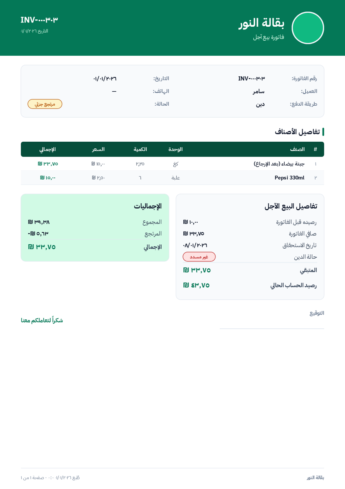
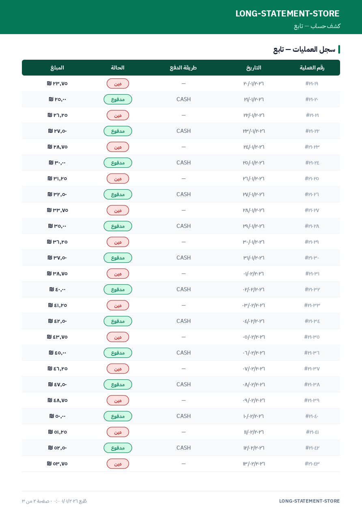
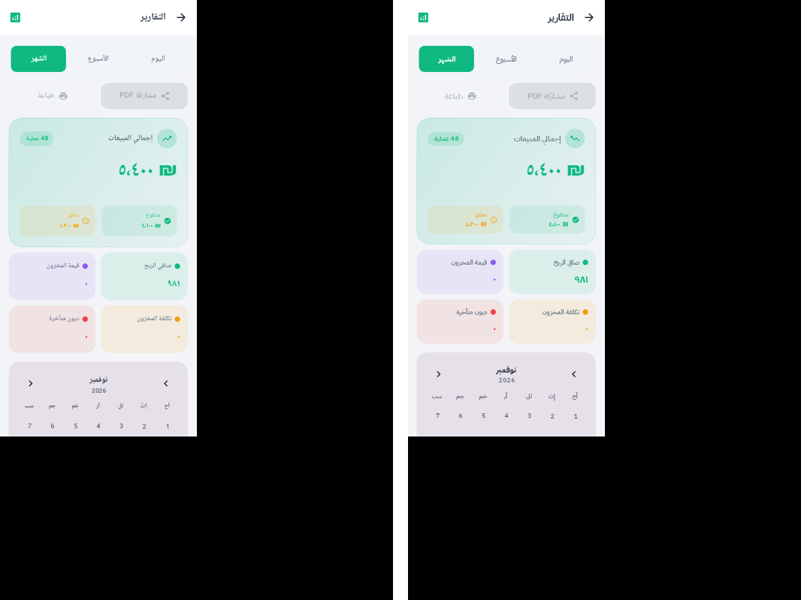
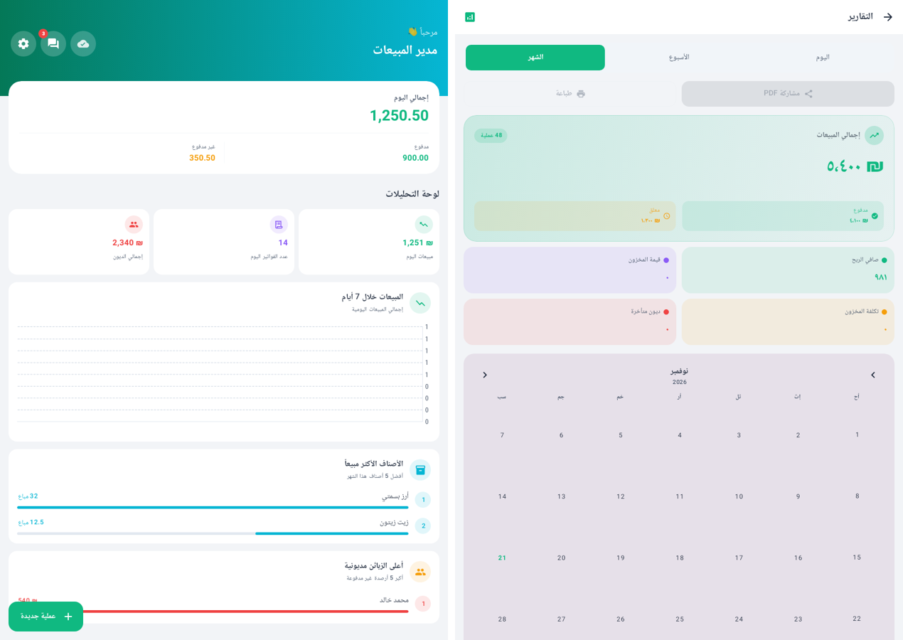

# تقرير تحديث SalesManager — نوفمبر 2026

الفرع: `chore/modernization-2026-11` — طلب الدمج: [mohammedakkad/SalesManager#52](https://github.com/mohammedakkad/SalesManager/pull/52) (مسودة)
نقطة البداية: `production` عند `fc8f9c6`.

---

## 1. الملخص التنفيذي

- **الامتثال لـ Google Play:** التطبيقات الثلاثة تُبنى الآن بـ `compileSdk/targetSdk 36` (Android 16) مع Gradle 9.9.2 و AGP 9.5.2 و Kotlin 2.4.21. تم إصلاح توافق **صفحات الذاكرة 16 KB** (كانت مكتبة CameraX القديمة غير متوافقة).
- **المكتبات:** تم تحديث جميع المكتبات إلى أحدث إصدار مستقر **متوافق مع compileSdk 36**، وإزالة وحدات Firebase KTX، والانتقال إلى Koin 4 و Coil 3. جميع الإصدارات في `libs.versions.toml`.
- **أخطاء حقيقية أُصلحت (مع اختبارات انحدار):** تجميد الواجهة بـ `runBlocking` في المظهر، انهيار التطبيق عند فشل مستمع المحادثة، قراءة `!!` لحالة حيّة داخل عنصر LazyColumn، **وكشف الحساب الذي كان يحذف كل العمليات بعد الـ 25 الأولى**.
- **إعادة تصميم ملفات PDF:** خط عربي مضمّن، أرقام عربية-هندية (١٢٣) من منسّق مركزي واحد، معالجة صحيحة لاتجاه النص، نظام تصميم ومكوّنات مشتركة، ترقيم صفحات "صفحة X من Y"، نسخة صديقة للطباعة.
- **الواجهة:** نفس الخط في التطبيق، أيقونات اتجاهية تنعكس بشكل صحيح في RTL، وأداة لقطات شاشة للمراجعة.
- **قرارات تحتاج صاحب المشروع:** انظر القسم 7.

---

## 2. خط الأساس مقابل الحالة النهائية

| البند | قبل (production) | بعد (هذا الفرع) |
|---|---|---|
| Gradle / AGP / Kotlin / KSP | 8.7 (CI: 8.9) / 8.3.2 / 2.0.21 / 2.0.21-1.0.27 | 9.9.2 / 9.5.2 (Kotlin مدمج) / 2.4.21 / 2.3.14 |
| compileSdk / targetSdk | 35 / 35 | **36 / 36** |
| اختبارات JVM | 1080 (285 + 795)، 0 فشل | **1105** (285 + 820)، 0 فشل |
| بوابات التغطية | ناجحة | ناجحة |
| Lint | 0 أخطاء / 27 تحذير | **0 أخطاء** / 55 تحذير (انظر 2.1) |
| مدة حزمة QA محلياً | ~8.5 دقيقة (تبريد كامل) | ~4–6 دقائق |
| بناء debug / staging / release مصغّر (seller) | ناجح | ناجح |
| بناء release (admin) | ناجح (يتطلب بيانات توقيع) | ناجح |
| اختبارات الأجهزة في CI (API 24/28/33/35) | فشل: اختبار كشف الحساب الطويل (60 صفاً) | انظر القسم 6 |
| محاذاة 16 KB للمكتبات الأصلية 64-bit | **غير متوافقة** (`libimage_processing_util_jni.so`) | متوافقة (كل المكتبات 2**14، zipalign -P 16 ناجح) |

### 2.1 لماذا زاد عدد تحذيرات lint رغم الإصلاحات؟
الإصدار الجديد من lint أضاف **كاشفات جديدة** لم تكن موجودة: `DefaultLocale` (33) و `UseKtx` (10) و `OldTargetApi` و `ModifierParameter`. كما أن تحديث Compose جعل فحوصات Compose تعمل فعلاً لأول مرة (كانت معطّلة سابقاً `ObsoleteLintCustomCheck`) فاكتشفت **4 أخطاء حقيقية أُصلحت**. التفاصيل في [`docs/qa/seller-lint-triage.md`](../qa/seller-lint-triage.md):
- أُصلح: `UseTomlInstead` (2)، `ObsoleteLintCustomCheck` (4)، `UseKtx` (10)، `NonObservableLocale` (2 أخطاء)، `StateFlowValueCalledInComposition` (2 أخطاء).
- متبقٍ عمداً: `DefaultLocale` (33) — مرتبط بقرار توحيد الأرقام في الواجهة (القسم 7)، تحذيرات أيقونة المشغّل (17، تحتاج تصميماً)، `StaticFieldLeak` (2)، `OldTargetApi`/`GradleDependency` (compileSdk 37 متاح).

---

## 3. المرحلة 1 — أدوات البناء والامتثال

| التغيير | التفاصيل |
|---|---|
| Gradle wrapper | 8.7 → **9.9.2** مع `distributionSha256Sum` |
| AGP | 8.3.2 → **9.5.2** (أحدث مستقر). تمت الهجرة إلى **Kotlin المدمج**: إزالة إضافة `kotlin-android` وتحويل `kotlinOptions` إلى `kotlin.compilerOptions` |
| DSL | `com.android.build.gradle.LibraryExtension` (مخفي في AGP 9) → `com.android.build.api.dsl.LibraryExtension`؛ تفعيل `resValues` لأن staging يستخدمه |
| Room | 2.6.1 → **2.8.5** — نُقل من المرحلة 2 بالضرورة: KSP 2.3 يعمل بوضع KSP2 فقط ومعالج Room 2.6 يفشل فيه (`unexpected jvm signature V`). المخططات المصدَّرة لم تتغير واختبارات الترحيل ناجحة |
| التغطية | `qa-coverage.gradle` يقرأ الآن الأصناف من مجلد `built_in_kotlinc` (المجلد القديم أصبح قديماً وسبّب عدم تطابق JaCoCo) |
| CI | سكربتات CI تثبّت SDK 36 و build-tools 36.0.0 و Gradle 9.9.2 بتحقق SHA-256؛ سير عمل الإصدار يستخدم الـ wrapper بدلاً من تنزيل Gradle 8.7 دون تحقق؛ أُضيف API 36 لمصفوفة المحاكي |
| bcprov | ما زال مطلوباً (`BackupCrypto`)؛ 1.87 هو أحدث إصدار؛ نُقل إلى الكتالوج مع `espresso-intents` و `mockwebserver` |

**مراجعة Android 16:** edge-to-edge مفعّل مسبقاً؛ لا يوجد `onBackPressed` (BackHandler في Compose متوافق مع الرجوع التنبؤي)؛ لا قفل للاتجاه؛ لا خدمات أمامية؛ مسار تثبيت التحديث (FileProvider + REQUEST_INSTALL_PACKAGES) دون تغيير. المشكلة الفعلية الوحيدة كانت 16 KB.

---

## 4. المرحلة 2 — المكتبات

القاعدة: أحدث إصدار **مستقر** تكون فيه قيمة `minCompileSdk` في بيانات AAR ≤ 36 (تم التحقق من ملفات AAR مباشرة من Google Maven / Maven Central).

| المكتبة | قبل | بعد | ملاحظة |
|---|---|---|---|
| Compose BOM | 2024.09.03 | **2026.06.01** (UI 1.11.4، M3 1.4.0) | BOM 2026.08+ (Compose 1.12) يتطلب compileSdk 37 |
| Navigation | 2.8.2 | 2.9.8 | 2.10 يتطلب 37 |
| Lifecycle | 2.8.6 | 2.10.0 | 2.11 (compose) يتطلب 37 |
| Activity | 1.9.2 | 1.13.0 | |
| Core | 1.13.1 | 1.18.0 | 1.19 يتطلب 37 |
| Firebase BoM | 33.4.0 | **35.2.0** | أُزيلت لاحقة `-ktx` من كل الوحدات؛ لم تكن هناك واردات KTX في الكود |
| Google Services / Crashlytics plugin | 4.4.2 / 3.0.2 | 4.6.0 / 3.0.8 | |
| Room | 2.6.1 | 2.8.5 | (المرحلة 1) |
| WorkManager | 2.9.1 | 2.12.0 | |
| CameraX | 1.3.4 | **1.7.0** | يصلح 16 KB |
| ML Kit barcode | 17.3.0 | 17.3.0 | الأحدث أصلاً |
| DataStore | 1.1.1 | 1.3.0 | |
| Coroutines | 1.9.0 | 1.11.0 | |
| OkHttp / MockWebServer | 4.12.0 | 5.4.0 | 5.5 يتطلب 37 |
| Gson | 2.10.1 | 2.15.0 | |
| Koin | 3.5.6 | **4.2.2** | نقل DSL الـ ViewModel إلى `org.koin.core.module.dsl`؛ إزالة `KoinContext` من الاختبارات |
| Coil | 2.5.0 | **3.5.0** | الحزمة `coil3`؛ إضافة `coil-network-okhttp`؛ تم التحقق أن R8 يحتفظ بمحمّل الشبكة |
| Vico | 1.15.0 | 1.15.0 | **مؤجَّل** (القسم 8) |
| androidx.startup | — | 1.2.0 | جديد (تحميل خط PDF) |
| Robolectric | 4.14.1 | 4.18.1 | ضروري: مع Compose ≥ 1.8 لم تكن اللمسات المحقونة تصل لنوافذ ModalBottomSheet |
| MockK / AndroidX Test / Espresso | 1.13.13 / 1.6.x / 3.6.1 | 1.14.12 / 1.7.0 / 3.7.0 | |

**تعديلات API:** `LocalClipboardManager` → `LocalClipboard` عبر دالة مشتركة `rememberPlainTextCopier()`؛ `menuAnchor()` → `menuAnchor(PrimaryNotEditable)`؛ قراءة اللغة من `LocalConfiguration` بدل `Locale.getDefault()` في دالتي تنسيق تاريخ.

**تعديلات اختبارات مقصودة:** اختبارا رسم المخطط يمرّران إلى عقدة المخطط نفسها لأن `performScrollToNode` في Compose ≥ 1.8 يمرّر بالحد الأدنى؛ قراءة `StateFlow.value` خارج التركيب في اختبار. لم يُعتمد مُشغّل الاختبار v2 (StandardTestDispatcher) لأنه يُفشل 21 اختباراً قائماً — الإصدار v1 ما زال مدعوماً.

---

## 5. المرحلة 3 — المشاكل المكتشفة والمُصلحة

| # | المشكلة | الدليل | الإصلاح | اختبار الانحدار |
|---|---|---|---|---|
| 1 | `runBlocking` في `ui/theme/Theme.kt` يحجب الخيط الرئيسي أثناء التركيب، وخطأ في DataStore كان يُسقط أول إطار | `Theme.kt:158` | قراءة غير متزامنة بقيمة أولية `null`؛ لا يُرسم المحتوى حتى تصل القيمة (لا إطار بالمظهر المعاكس)؛ تسخين DataStore في `SalesManagerApp` | `ThemePreferenceUiTest.pendingPreferenceReadNeitherBlocksNorShowsTheOppositeTheme` |
| 2 | **انهيار التطبيق** عند فشل مستمع Firestore للمحادثة (مثلاً `PERMISSION_DENIED` بعد إيقاف التاجر) أو عند كود تاجر فارغ | `ChatViewModel.loadChat` كان `launchIn` بلا `catch`؛ `ChatService.getMessages` يرمي استثناء | تدفق كسول + `catch` ينهي التحميل | اختباران في `ChatCommandsTest` **يفشلان على الكود القديم** وينجحان الآن |
| 3 | `!!` يعيد قراءة حالة حيّة داخل عنصر `LazyColumn` | `ReportsScreen.kt:387` | التقاط القيمة مرة واحدة | اختبارات التقارير |
| 4 | **كشف الحساب يحذف البيانات:** صفحة واحدة تتوقف بعد 25 عملية | `ExportManager.generateCustomerStatementPdf` (`take(25)`)؛ اختبار الجهاز في CI كان يفشل `actualPages=1` | مولّد جديد يقسّم الصفحات ويطبع كل العمليات | `PdfLayoutRenderTest.longCustomerStatementKeepsAllSixtyRows` + اختبار PDFBox على الجهاز |
| 5 | الأرقام غير متسقة في التطبيق (لاتينية في الرئيسية، عربية-هندية في التقارير حسب لغة الجهاز) | لقطات الجرد (القسم 9) | مُنسّق مركزي جاهز؛ التطبيق على الواجهة **ينتظر قرار المالك** | — |

**مراجعة إضافية:** تدقيق 52 موضع `!!` — الباقي محمي بفحص سابق لقيمة غير قابلة للتغيير، أو وسائط تنقّل مُعرّفة غير قابلة للقيمة الفارغة، أو مستندات استعلام Firestore (موجودة دائماً). مستمعو Firebase متوازنون (إضافة/إزالة/`awaitClose`) والتدفقات الحية تمر عبر `recoverSellerRealtime`.

**الأسرار:** راجع [قائمة التحقق](../security/secrets-checklist-ar.md). أهم بند: ملف `keystore_base64.txt` أُضيف في الكومِت `7a267e6` (2026-05-20) وما زال في تاريخ `production` — يجب اعتبار المفتاح مكشوفاً وإنشاء مفتاح رفع جديد قبل أول نشر على Play. لم يُدوَّر أي مفتاح ولم يُعَد كتابة التاريخ.

**التوثيق:** README محدّث بالكامل؛ 22 ملف `*progress*.md` نُقلت دون حذف إلى `docs/qa/archive/` مع تحديث الروابط؛ ملف حالة مختصر `docs/qa/README.md`.

---

## 6. المرحلة 4 — إعادة تصميم PDF

### القرارات
- **الخط:** IBM Plex Sans Arabic (رخصة OFL، الرخصة في `assets/licenses/`)، يُحمَّل مرة واحدة عبر `androidx.startup` مع بديل آمن.
- **الأرقام:** `AppNumberFormat` هو **المكان الوحيد** للتنسيق. التقريب كما كان (Locale.US، HALF_UP: 39.375 → ٣٩٫٣٨). فاصل عشري `٫` وفاصل آلاف `٬`. مفتاح واحد (`AppNumberFormat.digits`) يعيد الأرقام اللاتينية في كل مكان.
- **اتجاه النص:** الفقرات RTL، لكن كل رقم/تاريخ/معرّف يُعزل بـ LRI…PDI فلا تنقلب الإشارة أو العملة أو `#` أو `INV-`.
- **نصوص المستخدم** (أسماء المنتجات والعملاء، الهاتف، الملاحظات) تُطبع **كما أُدخلت** دون تحويل أرقامها.

### البنية (صنف واحد لكل ملف)
- `design/`: `PdfPalette` (أدوار ألوان + نسخة طباعة منخفضة الحبر)، `PdfTypeScale`، `PdfSpacing`، `PdfTextStyle`، `PdfOptions`.
- `core/`: `PdfDocumentBuilder` (يسجّل كل صفحة كـ Picture ثم يعيد رسمها مع الترويسة والتذييل بعد معرفة العدد الكلي)، `PdfTextPainter` و `PdfPaints` (تخزين مؤقت، قياس مرة ورسم مرة)، `PdfPageSink`، `PdfFonts`.
- `components/`: ترويسة، تذييل "صفحة X من Y"، جدول مع صفوف متناوبة وتكرار الرأس وعدم تقسيم الصفوف، بطاقة ملخص، بطاقة مؤشر، بطاقة معلومات، بطاقة ملاحظات، شارات حالة (مدفوع/آجل/مُرتجع/مرتجع جزئي)، شعار، علامة مائية.
- المولّدات: `InvoicePdfGenerator`، `ReportPdfGenerator`، و `CustomerStatementPdfGenerator` الجديد. **التواقيع العامة لم تتغير** (أُضيف معامل اختياري `options`).

### التحقق
- اختبارات JVM جديدة ترسم كل نوع مستند بالرسم الأصلي (Robolectric) وتتحقق من: وجود كل الصفوف، تكرار رأس الجدول في كل صفحة، عدم التداخل أو القص.
- فحصت الصور بنفسي: ترتيب الأرقام في التواريخ والمبالغ والمعرّفات صحيح، لا قص، الاتجاه صحيح.
- اختبارات PDFBox على الجهاز حُدّثت **عمداً** لأن الأرقام أصبحت عربية-هندية (دالة `ArabicDigits.ar()`)، والمجاميع أصبحت مُجمّعة (12,345.67) ومجموع كشف الحساب الطويل `1,125.00` بدل `1125`.
- نتيجة CI على المحاكي: انظر تعليق طلب الدمج الأخير.

### صور قبل/بعد (بعد)
| فاتورة قصيرة | فاتورة آجلة مع مرتجع وشعار |
|---|---|
|  |  |

| كشف حساب — صفحة ٢ (رأس متكرر) | تقرير شهري — صفحة ١ |
|---|---|
|  |  |

| فاتورة طويلة — صفحة ٢ | نسخة الطباعة + علامة مائية |
|---|---|
|  |  |

صورة "قبل": المولّد القديم لا يمكن رسمه في JVM (يحتاج PdfDocument على جهاز)؛ ملفات PDF القديمة الحقيقية محفوظة في مخرجات CI السابقة (`seller-compose-results-api-*`).

---

## 7. قرارات تحتاج صاحب المشروع

1. **`runBlocking` في تعريف Koin لـ `merchantId`** (`di/SalesManagerModule.kt`): التعريف `single` يثبّت كود التاجر **عند أول استخدام طوال عمر العملية**. 9 أصناف تعتمد عليه، وبعضها يستخدمه كحارس عزل بين المستأجرين (مثلاً `InventoryRepositoryImpl`: `require(merchantId == this.merchantId)`). إزالة الحجب تعني تحويله إلى "الكود الحالي" — وهذا **تغيير في سلوك العزل الأمني** يمس ~29 ملف اختبار. لم أنفذه دون موافقتك. الخيارات: (أ) مزوّد `suspend` في الأصناف التسعة، (ب) الإبقاء مع توثيق.
2. **توحيد الأرقام في الواجهة:** حالياً مختلطة (لاتينية/عربية-هندية حسب الشاشة ولغة الجهاز). المنسّق المركزي جاهز. هل تريد العربية-الهندية في الواجهة أيضاً (متسقة مع PDF)؟ سيتطلب تحديث اختبارات واجهة تتحقق من نصوص رقمية. الإدخال يقبل النظامين أصلاً.
3. **compileSdk 37:** يفتح Compose 1.12+، M3 1.5، OkHttp 5.5، Coil 3.6، Core 1.19. لا يغيّر سلوك التشغيل (targetSdk يبقى 36).
4. **FCM:** الإصدار 25.1 أهمل `getToken/onNewToken` لصالح التسجيل بـ FID — يغيّر طريقة توجيه الخادم للإشعارات.
5. **مفتاح التوقيع المكشوف وسير عمل الإصدار:** انظر قائمة الأسرار.

---

## 8. بنود مؤجلة وأسبابها

| البند | السبب |
|---|---|
| Room 3 | مشروع منفصل (تغيير الحزمة إلى `androidx.room3`) حسب التعليمات |
| Vico 1.15 → 3.x | الإصدار الحالي 3.x (ليس 2.x)؛ إعادة كتابة كاملة لمخطط واحد يعمل بشكل صحيح واختباره البكسلي؛ الفائدة صغيرة |
| مُشغّل اختبار Compose v2 | يُفشل 21 اختبار واجهة قائماً؛ يحتاج مزامنة صريحة في كل اختبار |
| ترتيب معامل `modifier` في `SharedComponents` | تغيير API لمواقع الاستدعاء |
| تخطيط الشاشات العريضة (حد أقصى لعرض المحتوى) | ملاحظ في لقطات الجهاز اللوحي؛ يحتاج قراراً تصميمياً |
| 22 زر أيقونة بلا وصف (contentDescription) | يحتاج نصوص عربية مناسبة لكل زر (أكثرها في المحادثة وتفاصيل العملية والزبائن) |
| أيقونة المشغّل (17 تحذير) | تحتاج تصميماً |

---

## 9. المرحلة 5 — الواجهة

**الجرد أولاً:** `UiInventoryScreenshotTest` يرسم الرئيسية والتقارير وعمليات اليوم والمكوّنات المشتركة باللغة العربية (RTL) في: هاتف فاتح/داكن، هاتف بخط 1.3×، جهاز لوحي.

**الملاحظات:**
- خط النظام (Roboto) يختلف عن خط المستندات.
- أيقونات اتجاهية (السهم، الاتجاه الصاعد، الإرسال، التراجع...) **لا تنعكس** في RTL.
- أرقام مختلطة بين الشاشات (انظر القسم 7).
- بخط 1.3× يُقص عنوان بطاقة المخطط في الرئيسية.
- على الجهاز اللوحي يمتد المحتوى بكامل العرض.

**ما تم تطبيقه:** الخط المضمّن في `Type.kt` (أربعة أوزان للحفاظ على التسلسل)، و 39 أيقونة اتجاهية في 25 ملفاً → `AutoMirrored`. التنقل ومنطق الأعمال لم يُمسّا.

| الرئيسية: قبل ← → بعد | التقارير: قبل ← → بعد |
|---|---|
|  |  |

جرد (قبل): عدم اتساق الأرقام والجهاز اللوحي:

---

## 10. المخاطر

- اختبارات الأجهزة لا يمكن تشغيلها محلياً (لا KVM)؛ الاعتماد على CI. الدفعات السابقة نجحت على API 24–36 باستثناء اختبار كشف الحساب الذي أصلحته المرحلة 4.
- `targetSdk 36` يفعّل سلوكيات Android 16؛ المراجعة لم تجد مشاكل، لكن يُنصح بتجربة يدوية على جهاز Android 16 (الرجوع التنبؤي، تثبيت التحديث).
- خط PDF يُحمَّل عند بدء العملية؛ إن فشل لأي سبب يُستخدم sans-serif (لا انهيار، لكن الشكل يختلف).
- جاهزية الإصدار ما زالت **FAIL** حسب وثائق QA السابقة (تفويض الخادم، عزل المستأجر القديم) — هذا العمل لا يغيّر ذلك.
