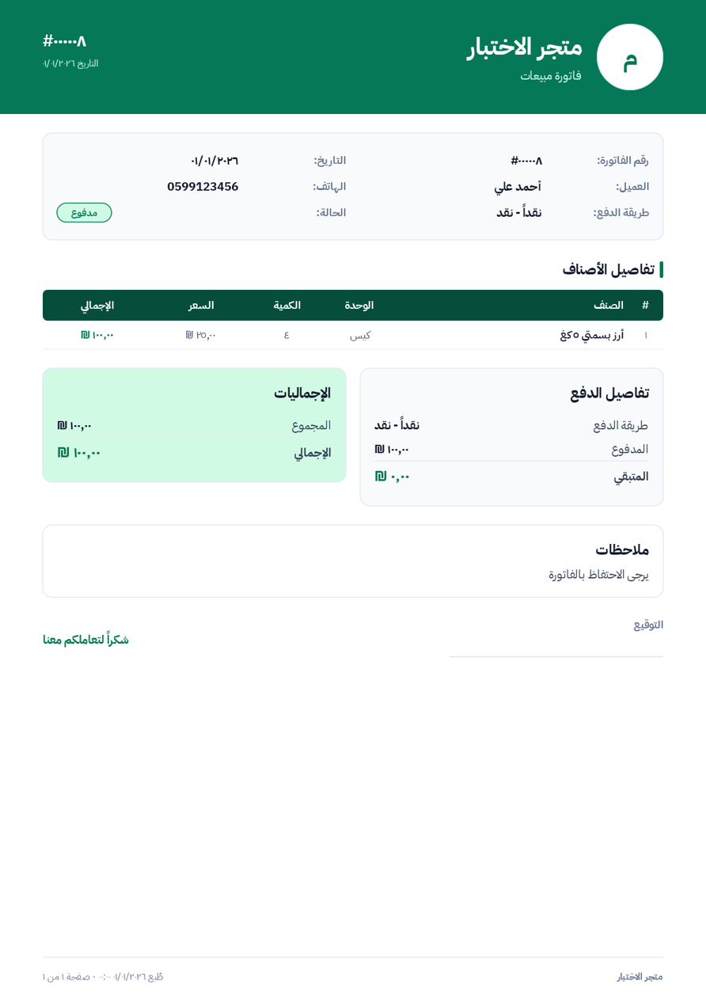
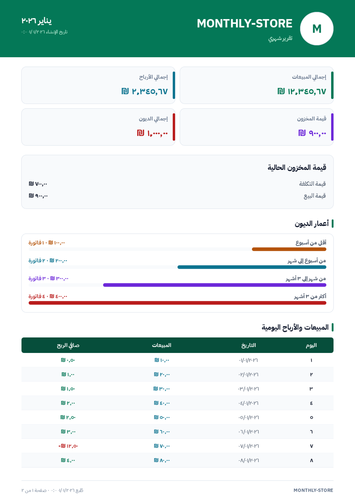
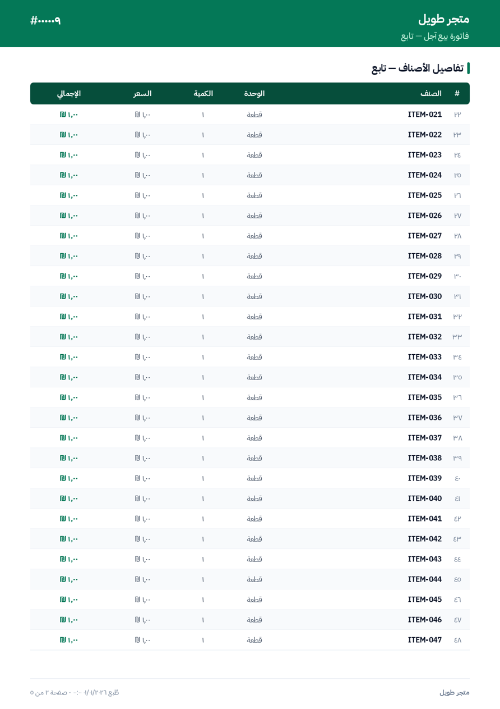
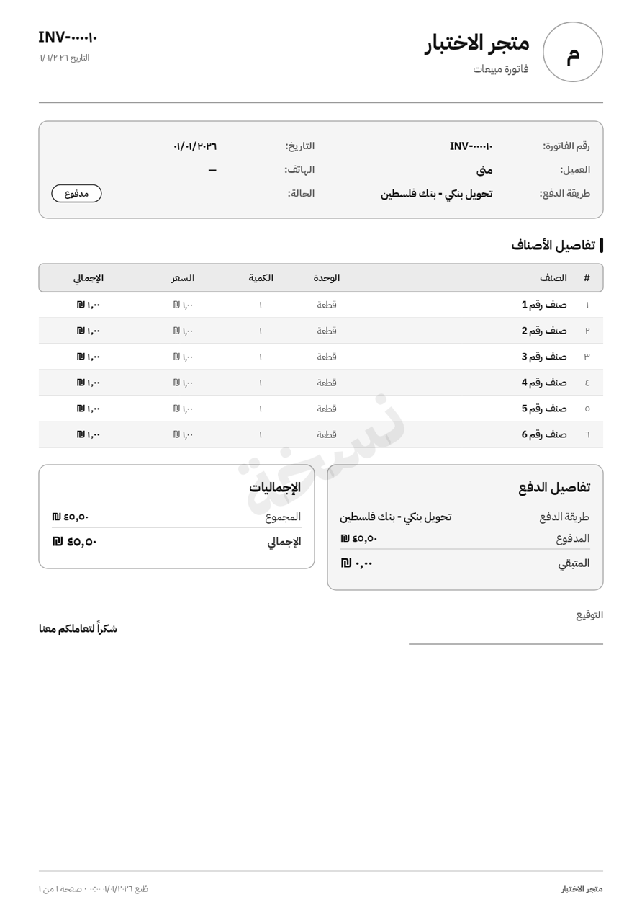
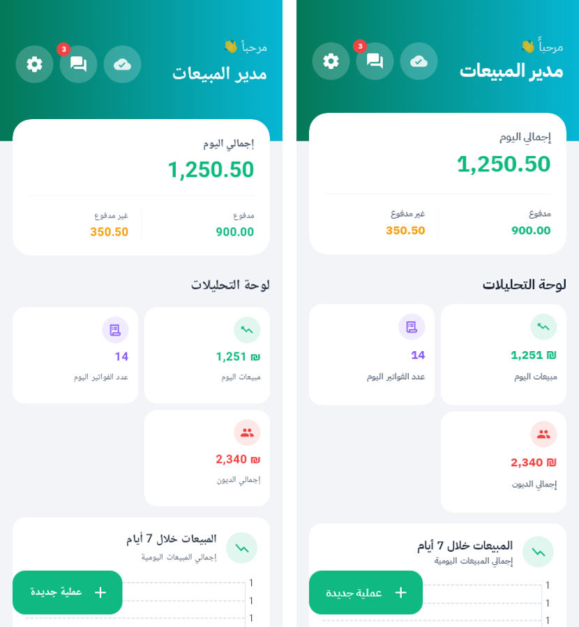
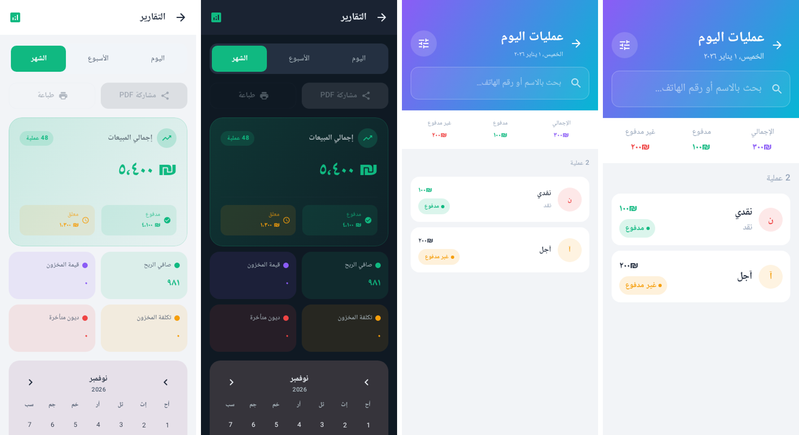

# تقرير تحديث SalesManager — نوفمبر 2026

الفرع: `chore/modernization-2026-11` — طلب الدمج: [mohammedakkad/SalesManager#52](https://github.com/mohammedakkad/SalesManager/pull/52) (مسودة)
نقطة البداية: `production` عند `fc8f9c6`.

---

## 1. الملخص التنفيذي

- **الامتثال لـ Google Play:** التطبيقات الثلاثة تُبنى الآن بـ `compileSdk/targetSdk 36` (Android 16) مع Gradle 9.9.2 و AGP 9.5.2 و Kotlin 2.4.21. تم إصلاح توافق **صفحات الذاكرة 16 KB** (كانت مكتبة CameraX القديمة غير متوافقة).
- **المكتبات:** تم تحديث جميع المكتبات إلى أحدث إصدار مستقر **متوافق مع compileSdk 36**، وإزالة وحدات Firebase KTX، والانتقال إلى Koin 4 و Coil 3. جميع الإصدارات في `libs.versions.toml`.
- **أخطاء حقيقية أُصلحت (مع اختبارات انحدار):** تجميد الواجهة بـ `runBlocking` في المظهر، انهيار التطبيق عند فشل مستمع المحادثة، قراءة `!!` لحالة حيّة داخل عنصر LazyColumn، **وكشف الحساب الذي كان يحذف كل العمليات بعد الـ 25 الأولى**.
- **إعادة تصميم ملفات PDF:** خط عربي مضمّن، أرقام عربية-هندية (١٢٣) من منسّق مركزي واحد، معالجة صحيحة لاتجاه النص، نظام تصميم ومكوّنات مشتركة، ترقيم صفحات "صفحة X من Y"، نسخة صديقة للطباعة.
- **الواجهة:** نفس الخط في التطبيق، أيقونات اتجاهية تنعكس بشكل صحيح في RTL، وأداة لقطات شاشة للمراجعة.
- **قرارات تحتاج صاحب المشروع:** انظر القسم 7.

---

## 2. خط الأساس مقابل الحالة النهائية

| البند | قبل (production) | بعد (هذا الفرع) |
|---|---|---|
| Gradle / AGP / Kotlin / KSP | 8.7 (CI: 8.9) / 8.3.2 / 2.0.21 / 2.0.21-1.0.27 | 9.9.2 / 9.5.2 (Kotlin مدمج) / 2.4.21 / 2.3.14 |
| compileSdk / targetSdk | 35 / 35 | **36 / 36** |
| اختبارات JVM | 1080 (285 + 795)، 0 فشل | **1105** (285 + 820)، 0 فشل |
| بوابات التغطية | ناجحة | ناجحة |
| Lint | 0 أخطاء / 27 تحذير | **0 أخطاء** / 55 تحذير (انظر 2.1) |
| مدة حزمة QA محلياً | ~8.5 دقيقة (تبريد كامل) | ~4–6 دقائق |
| بناء debug / staging / release مصغّر (seller) | ناجح | ناجح |
| بناء release (admin) | ناجح (يتطلب بيانات توقيع) | ناجح |
| اختبارات الأجهزة في CI | API 24/28/33/35: فشل (كشف الحساب الطويل 60 صفاً) | **API 24/28/33/35/36: كلها ناجحة** (التشغيل #81) |
| محاذاة 16 KB للمكتبات الأصلية 64-bit | **غير متوافقة** (`libimage_processing_util_jni.so`) | متوافقة (كل المكتبات 2**14، zipalign -P 16 ناجح) |

### 2.1 لماذا زاد عدد تحذيرات lint رغم الإصلاحات؟
الإصدار الجديد من lint أضاف **كاشفات جديدة** لم تكن موجودة: `DefaultLocale` (33) و `UseKtx` (10) و `OldTargetApi` و `ModifierParameter`. كما أن تحديث Compose جعل فحوصات Compose تعمل فعلاً لأول مرة (كانت معطّلة سابقاً `ObsoleteLintCustomCheck`) فاكتشفت **4 أخطاء حقيقية أُصلحت**. التفاصيل في [`docs/qa/seller-lint-triage.md`](../qa/seller-lint-triage.md):
- أُصلح: `UseTomlInstead` (2)، `ObsoleteLintCustomCheck` (4)، `UseKtx` (10)، `NonObservableLocale` (2 أخطاء)، `StateFlowValueCalledInComposition` (2 أخطاء).
- متبقٍ عمداً: `DefaultLocale` (33) — مرتبط بقرار توحيد الأرقام في الواجهة (القسم 7)، تحذيرات أيقونة المشغّل (17، تحتاج تصميماً)، `StaticFieldLeak` (2)، `OldTargetApi`/`GradleDependency` (compileSdk 37 متاح).

---

## 3. المرحلة 1 — أدوات البناء والامتثال

| التغيير | التفاصيل |
|---|---|
| Gradle wrapper | 8.7 → **9.9.2** مع `distributionSha256Sum` |
| AGP | 8.3.2 → **9.5.2** (أحدث مستقر). تمت الهجرة إلى **Kotlin المدمج**: إزالة إضافة `kotlin-android` وتحويل `kotlinOptions` إلى `kotlin.compilerOptions` |
| DSL | `com.android.build.gradle.LibraryExtension` (مخفي في AGP 9) → `com.android.build.api.dsl.LibraryExtension`؛ تفعيل `resValues` لأن staging يستخدمه |
| Room | 2.6.1 → **2.8.5** — نُقل من المرحلة 2 بالضرورة: KSP 2.3 يعمل بوضع KSP2 فقط ومعالج Room 2.6 يفشل فيه (`unexpected jvm signature V`). المخططات المصدَّرة لم تتغير واختبارات الترحيل ناجحة |
| التغطية | `qa-coverage.gradle` يقرأ الآن الأصناف من مجلد `built_in_kotlinc` (المجلد القديم أصبح قديماً وسبّب عدم تطابق JaCoCo) |
| CI | سكربتات CI تثبّت SDK 36 و build-tools 36.0.0 و Gradle 9.9.2 بتحقق SHA-256؛ سير عمل الإصدار يستخدم الـ wrapper بدلاً من تنزيل Gradle 8.7 دون تحقق؛ أُضيف API 36 لمصفوفة المحاكي |
| bcprov | ما زال مطلوباً (`BackupCrypto`)؛ 1.87 هو أحدث إصدار؛ نُقل إلى الكتالوج مع `espresso-intents` و `mockwebserver` |

**مراجعة Android 16:** edge-to-edge مفعّل مسبقاً؛ لا يوجد `onBackPressed` (BackHandler في Compose متوافق مع الرجوع التنبؤي)؛ لا قفل للاتجاه؛ لا خدمات أمامية؛ مسار تثبيت التحديث (FileProvider + REQUEST_INSTALL_PACKAGES) دون تغيير. المشكلة الفعلية الوحيدة كانت 16 KB.

---

## 4. المرحلة 2 — المكتبات

القاعدة: أحدث إصدار **مستقر** تكون فيه قيمة `minCompileSdk` في بيانات AAR ≤ 36 (تم التحقق من ملفات AAR مباشرة من Google Maven / Maven Central).

| المكتبة | قبل | بعد | ملاحظة |
|---|---|---|---|
| Compose BOM | 2024.09.03 | **2026.06.01** (UI 1.11.4، M3 1.4.0) | BOM 2026.08+ (Compose 1.12) يتطلب compileSdk 37 |
| Navigation | 2.8.2 | 2.9.8 | 2.10 يتطلب 37 |
| Lifecycle | 2.8.6 | 2.10.0 | 2.11 (compose) يتطلب 37 |
| Activity | 1.9.2 | 1.13.0 | |
| Core | 1.13.1 | 1.18.0 | 1.19 يتطلب 37 |
| Firebase BoM | 33.4.0 | **35.2.0** | أُزيلت لاحقة `-ktx` من كل الوحدات؛ لم تكن هناك واردات KTX في الكود |
| Google Services / Crashlytics plugin | 4.4.2 / 3.0.2 | 4.6.0 / 3.0.8 | |
| Room | 2.6.1 | 2.8.5 | (المرحلة 1) |
| WorkManager | 2.9.1 | 2.12.0 | |
| CameraX | 1.3.4 | **1.7.0** | يصلح 16 KB |
| ML Kit barcode | 17.3.0 | 17.3.0 | الأحدث أصلاً |
| DataStore | 1.1.1 | 1.3.0 | |
| Coroutines | 1.9.0 | 1.11.0 | |
| OkHttp / MockWebServer | 4.12.0 | 5.4.0 | 5.5 يتطلب 37 |
| Gson | 2.10.1 | 2.15.0 | |
| Koin | 3.5.6 | **4.2.2** | نقل DSL الـ ViewModel إلى `org.koin.core.module.dsl`؛ إزالة `KoinContext` من الاختبارات |
| Coil | 2.5.0 | **3.5.0** | الحزمة `coil3`؛ إضافة `coil-network-okhttp`؛ تم التحقق أن R8 يحتفظ بمحمّل الشبكة |
| Vico | 1.15.0 | 1.15.0 | **مؤجَّل** (القسم 8) |
| androidx.startup | — | 1.2.0 | جديد (تحميل خط PDF) |
| Robolectric | 4.14.1 | 4.18.1 | ضروري: مع Compose ≥ 1.8 لم تكن اللمسات المحقونة تصل لنوافذ ModalBottomSheet |
| MockK / AndroidX Test / Espresso | 1.13.13 / 1.6.x / 3.6.1 | 1.14.12 / 1.7.0 / 3.7.0 | |

**تعديلات API:** `LocalClipboardManager` → `LocalClipboard` عبر دالة مشتركة `rememberPlainTextCopier()`؛ `menuAnchor()` → `menuAnchor(PrimaryNotEditable)`؛ قراءة اللغة من `LocalConfiguration` بدل `Locale.getDefault()` في دالتي تنسيق تاريخ.

**تعديلات اختبارات مقصودة:** اختبارا رسم المخطط يمرّران إلى عقدة المخطط نفسها لأن `performScrollToNode` في Compose ≥ 1.8 يمرّر بالحد الأدنى؛ قراءة `StateFlow.value` خارج التركيب في اختبار. لم يُعتمد مُشغّل الاختبار v2 (StandardTestDispatcher) لأنه يُفشل 21 اختباراً قائماً — الإصدار v1 ما زال مدعوماً.

---

## 5. المرحلة 3 — المشاكل المكتشفة والمُصلحة

| # | المشكلة | الدليل | الإصلاح | اختبار الانحدار |
|---|---|---|---|---|
| 1 | `runBlocking` في `ui/theme/Theme.kt` يحجب الخيط الرئيسي أثناء التركيب، وخطأ في DataStore كان يُسقط أول إطار | `Theme.kt:158` | قراءة غير متزامنة بقيمة أولية `null`؛ لا يُرسم المحتوى حتى تصل القيمة (لا إطار بالمظهر المعاكس)؛ تسخين DataStore في `SalesManagerApp` | `ThemePreferenceUiTest.pendingPreferenceReadNeitherBlocksNorShowsTheOppositeTheme` |
| 2 | **انهيار التطبيق** عند فشل مستمع Firestore للمحادثة (مثلاً `PERMISSION_DENIED` بعد إيقاف التاجر) أو عند كود تاجر فارغ | `ChatViewModel.loadChat` كان `launchIn` بلا `catch`؛ `ChatService.getMessages` يرمي استثناء | تدفق كسول + `catch` ينهي التحميل | اختباران في `ChatCommandsTest` **يفشلان على الكود القديم** وينجحان الآن |
| 3 | `!!` يعيد قراءة حالة حيّة داخل عنصر `LazyColumn` | `ReportsScreen.kt:387` | التقاط القيمة مرة واحدة | اختبارات التقارير |
| 4 | **كشف الحساب يحذف البيانات:** صفحة واحدة تتوقف بعد 25 عملية | `ExportManager.generateCustomerStatementPdf` (`take(25)`)؛ اختبار الجهاز في CI كان يفشل `actualPages=1` | مولّد جديد يقسّم الصفحات ويطبع كل العمليات | `PdfLayoutRenderTest.longCustomerStatementKeepsAllSixtyRows` + اختبار PDFBox على الجهاز |
| 5 | الأرقام غير متسقة في التطبيق (لاتينية في الرئيسية، عربية-هندية في التقارير حسب لغة الجهاز) | لقطات الجرد (القسم 9) | مُنسّق مركزي جاهز؛ التطبيق على الواجهة **ينتظر قرار المالك** | — |

**مراجعة إضافية:** تدقيق 52 موضع `!!` — الباقي محمي بفحص سابق لقيمة غير قابلة للتغيير، أو وسائط تنقّل مُعرّفة غير قابلة للقيمة الفارغة، أو مستندات استعلام Firestore (موجودة دائماً). مستمعو Firebase متوازنون (إضافة/إزالة/`awaitClose`) والتدفقات الحية تمر عبر `recoverSellerRealtime`.

**الأسرار:** راجع [قائمة التحقق](../security/secrets-checklist-ar.md). أهم بند: ملف `keystore_base64.txt` أُضيف في الكومِت `7a267e6` (2026-05-20) وما زال في تاريخ `production` — يجب اعتبار المفتاح مكشوفاً وإنشاء مفتاح رفع جديد قبل أول نشر على Play. لم يُدوَّر أي مفتاح ولم يُعَد كتابة التاريخ.

**التوثيق:** README محدّث بالكامل؛ 22 ملف `*progress*.md` نُقلت دون حذف إلى `docs/qa/archive/` مع تحديث الروابط؛ ملف حالة مختصر `docs/qa/README.md`.

---

## 6. المرحلة 4 — إعادة تصميم PDF

### القرارات
- **الخط:** IBM Plex Sans Arabic (رخصة OFL، الرخصة في `assets/licenses/`)، يُحمَّل مرة واحدة عبر `androidx.startup` مع بديل آمن.
- **الأرقام:** `AppNumberFormat` هو **المكان الوحيد** للتنسيق. التقريب كما كان (Locale.US، HALF_UP: 39.375 → ٣٩٫٣٨). فاصل عشري `٫` وفاصل آلاف `٬`. مفتاح واحد (`AppNumberFormat.digits`) يعيد الأرقام اللاتينية في كل مكان.
- **اتجاه النص:** الفقرات RTL، لكن كل رقم/تاريخ/معرّف يُعزل بـ LRI…PDI فلا تنقلب الإشارة أو العملة أو `#` أو `INV-`.
- **نصوص المستخدم** (أسماء المنتجات والعملاء، الهاتف، الملاحظات) تُطبع **كما أُدخلت** دون تحويل أرقامها.

### البنية (صنف واحد لكل ملف)
- `design/`: `PdfPalette` (أدوار ألوان + نسخة طباعة منخفضة الحبر)، `PdfTypeScale`، `PdfSpacing`، `PdfTextStyle`، `PdfOptions`.
- `core/`: `PdfDocumentBuilder` (يسجّل كل صفحة كـ Picture ثم يعيد رسمها مع الترويسة والتذييل بعد معرفة العدد الكلي)، `PdfTextPainter` و `PdfPaints` (تخزين مؤقت، قياس مرة ورسم مرة)، `PdfPageSink`، `PdfFonts`.
- `components/`: ترويسة، تذييل "صفحة X من Y"، جدول مع صفوف متناوبة وتكرار الرأس وعدم تقسيم الصفوف، بطاقة ملخص، بطاقة مؤشر، بطاقة معلومات، بطاقة ملاحظات، شارات حالة (مدفوع/آجل/مُرتجع/مرتجع جزئي)، شعار، علامة مائية.
- المولّدات: `InvoicePdfGenerator`، `ReportPdfGenerator`، و `CustomerStatementPdfGenerator` الجديد. **التواقيع العامة لم تتغير** (أُضيف معامل اختياري `options`).

### التحقق
- اختبارات JVM جديدة ترسم كل نوع مستند بالرسم الأصلي (Robolectric) وتتحقق من: وجود كل الصفوف، تكرار رأس الجدول في كل صفحة، عدم التداخل أو القص.
- فحصت الصور بنفسي: ترتيب الأرقام في التواريخ والمبالغ والمعرّفات صحيح، لا قص، الاتجاه صحيح.
- رقم المستند يُطبع `#٠٠٠٣٠٣` بدل `INV-٠٠٠٣٠٣`: الرمز المختلط (لاتيني + أرقام عربية-هندية) يُعاد ترتيبه عند استخراج النص/البحث في قارئات PDF (اكتشفه اختبار PDFBox على المحاكي)، بينما الرمز أحادي النص يُستخرج صحيحاً. نوع المستند يظهر في التسمية "رقم الفاتورة".
- اختبارات PDFBox على الجهاز حُدّثت **عمداً** لأن الأرقام أصبحت عربية-هندية (دالة `ArabicDigits.ar()`)، والمجاميع أصبحت مُجمّعة (12,345.67) ومجموع كشف الحساب الطويل `1,125.00` بدل `1125`.
- نتيجة CI على المحاكي (التشغيل #75): نجح اختبار كشف الحساب الطويل (60 صفاً) لأول مرة، وكل المبالغ والتواريخ بالأرقام العربية-الهندية؛ فشلت فقط فحوص رقم الفاتورة المختلط، وأُصلحت أعلاه.

### صور قبل/بعد (بعد)
| فاتورة قصيرة | فاتورة آجلة مع مرتجع وشعار |
|---|---|
|  |  |

| كشف حساب — صفحة ٢ (رأس متكرر) | تقرير شهري — صفحة ١ |
|---|---|
|  |  |

| فاتورة طويلة — صفحة ٢ | نسخة الطباعة + علامة مائية |
|---|---|
|  |  |

صورة "قبل": المولّد القديم لا يمكن رسمه في JVM (يحتاج PdfDocument على جهاز)؛ ملفات PDF القديمة الحقيقية محفوظة في مخرجات CI السابقة (`seller-compose-results-api-*`).

---

## 7. قرارات تحتاج صاحب المشروع

1. **`runBlocking` في تعريف Koin لـ `merchantId`** (`di/SalesManagerModule.kt`): التعريف `single` يثبّت كود التاجر **عند أول استخدام طوال عمر العملية**. 9 أصناف تعتمد عليه، وبعضها يستخدمه كحارس عزل بين المستأجرين (مثلاً `InventoryRepositoryImpl`: `require(merchantId == this.merchantId)`). إزالة الحجب تعني تحويله إلى "الكود الحالي" — وهذا **تغيير في سلوك العزل الأمني** يمس ~29 ملف اختبار. لم أنفذه دون موافقتك. الخيارات: (أ) مزوّد `suspend` في الأصناف التسعة، (ب) الإبقاء مع توثيق.
2. **توحيد الأرقام في الواجهة:** حالياً مختلطة (لاتينية/عربية-هندية حسب الشاشة ولغة الجهاز). المنسّق المركزي جاهز. هل تريد العربية-الهندية في الواجهة أيضاً (متسقة مع PDF)؟ سيتطلب تحديث اختبارات واجهة تتحقق من نصوص رقمية. الإدخال يقبل النظامين أصلاً.
3. **compileSdk 37:** يفتح Compose 1.12+، M3 1.5، OkHttp 5.5، Coil 3.6، Core 1.19. لا يغيّر سلوك التشغيل (targetSdk يبقى 36).
4. **FCM:** الإصدار 25.1 أهمل `getToken/onNewToken` لصالح التسجيل بـ FID — يغيّر طريقة توجيه الخادم للإشعارات.
5. **مفتاح التوقيع المكشوف وسير عمل الإصدار:** انظر قائمة الأسرار.

---

## 8. بنود مؤجلة وأسبابها

| البند | السبب |
|---|---|
| Room 3 | مشروع منفصل (تغيير الحزمة إلى `androidx.room3`) حسب التعليمات |
| Vico 1.15 → 3.x | الإصدار الحالي 3.x (ليس 2.x)؛ إعادة كتابة كاملة لمخطط واحد يعمل بشكل صحيح واختباره البكسلي؛ الفائدة صغيرة |
| مُشغّل اختبار Compose v2 | يُفشل 21 اختبار واجهة قائماً؛ يحتاج مزامنة صريحة في كل اختبار |
| ترتيب معامل `modifier` في `SharedComponents` | تغيير API لمواقع الاستدعاء |
| تخطيط الشاشات العريضة (حد أقصى لعرض المحتوى) | ملاحظ في لقطات الجهاز اللوحي؛ يحتاج قراراً تصميمياً |
| 22 زر أيقونة بلا وصف (contentDescription) | يحتاج نصوص عربية مناسبة لكل زر (أكثرها في المحادثة وتفاصيل العملية والزبائن) |
| أيقونة المشغّل (17 تحذير) | تحتاج تصميماً |

---

## 9. المرحلة 5 — الواجهة

**الجرد أولاً:** `UiInventoryScreenshotTest` يرسم الرئيسية والتقارير وعمليات اليوم والمكوّنات المشتركة باللغة العربية (RTL) في: هاتف فاتح/داكن، هاتف بخط 1.3×، جهاز لوحي.

**الملاحظات:**
- خط النظام (Roboto) يختلف عن خط المستندات.
- أيقونات اتجاهية (السهم، الاتجاه الصاعد، الإرسال، التراجع...) **لا تنعكس** في RTL.
- أرقام مختلطة بين الشاشات (انظر القسم 7).
- بخط 1.3× يُقص عنوان بطاقة المخطط في الرئيسية.
- على الجهاز اللوحي يمتد المحتوى بكامل العرض.

**ما تم تطبيقه:** الخط المضمّن في `Type.kt` (أربعة أوزان للحفاظ على التسلسل)، و 39 أيقونة اتجاهية في 25 ملفاً → `AutoMirrored`. التنقل ومنطق الأعمال لم يُمسّا.

| الرئيسية: قبل ← → بعد | التقارير: قبل ← → بعد |
|---|---|
|  |  |

جرد (قبل): عدم اتساق الأرقام والجهاز اللوحي:

---

## 9.1 مسار التحقق في CI (للشفافية)
| التشغيل | النتيجة |
|---|---|
| #74 (المرحلة 3) | كل شيء ناجح على API 24–36 ما عدا اختبار كشف الحساب الطويل (الخلل القديم) |
| #75 (المرحلة 4) | كشف الحساب نجح؛ فشل استخراج `INV-٠٠٠…` المختلط ← أُصلح برقم `#` |
| #78 | فشل واحد: اسم طريقة الدفع مقصوص بعلامة الحذف ← أُصلح بالتفاف النص |
| #80 | كل الاختبارات ناجحة؛ فشل حارس التغطية لأنه يشير إلى `PdfCanvas.kt` المحذوف ← حُدّث |
| **#81** | **ناجح بالكامل** على API 24/28/33/35/36 + seller + بناءا الإصدار |

## 10. المخاطر

- اختبارات الأجهزة لا يمكن تشغيلها محلياً (لا KVM)؛ تم التحقق عبر CI: التشغيل #81 ناجح بالكامل على API 24/28/33/35/36 (19 اختبار أجهزة + 10 فحوص PDFBox + سلامة التغطية).
- `targetSdk 36` يفعّل سلوكيات Android 16؛ المراجعة لم تجد مشاكل، لكن يُنصح بتجربة يدوية على جهاز Android 16 (الرجوع التنبؤي، تثبيت التحديث).
- خط PDF يُحمَّل عند بدء العملية؛ إن فشل لأي سبب يُستخدم sans-serif (لا انهيار، لكن الشكل يختلف).
- جاهزية الإصدار ما زالت **FAIL** حسب وثائق QA السابقة (تفويض الخادم، عزل المستأجر القديم) — هذا العمل لا يغيّر ذلك.

---

## 11. المرحلة 6 — العزل، اللغة/الاتجاه/الأرقام، تدقيق إعادة التركيب، بوابات الجودة

الفرع: `chore/phase6-hardening` (مبني فوق `chore/modernization-2026-11` لأن PR #52 لم يُدمج بعد)، PR مسودة #53 إلى `production`.
البنود 1 و2 في القسم 7، وبنود «Compose v2» و«ترتيب `modifier`» و«الشاشات العريضة» و«أزرار الأيقونات» في القسم 8، **أُنجزت كلها في هذه المرحلة** (التفاصيل أدناه).

### 11.1 عزل التاجر (6A) — الدليل والقرار

**الاختبار أولاً:** `MerchantIsolationTest` يبني رسم Koin الحقيقي (`salesManagerModule`) في عملية واحدة، ويُفعّل التاجر A، ثم يلغي التفعيل ويُفعّل B — تماماً كما يفعل `ActivationViewModel.deactivate()` و`MerchantWatcherViewModel`. ست حالات: الموظفون، رسم حُلّ قبل التفعيل، جلسات الجرد، مسار Firebase لإلغاء الجلسات، الصندوق الصادر المعلّق لـ A، والإلغاء التلقائي من المراقب. **قبل الإصلاح فشلت 5 من 6** — أي أن التسرب حقيقي وليس نظرياً.

**الأصناف المثبَّتة على كود التاجر (9) وتصنيفها بالدليل:**

| الصنف | الاستخدام | الحكم |
|---|---|---|
| `EmployeeRepositoryImpl` | قراءة/كتابة الموظفين | **تسرب**: موظفو B يُكتبون تحت A |
| `InventoryRepositoryImpl` | حارس `require(merchantId == this.merchantId)` | **تسرب**: الحارس يقارن بالتاجر القديم فيرفض B |
| `InventorySessionViewModel` | بدء جلسة جرد | **تسرب** |
| `SessionsViewModel` | مسار `merchants/{id}/sessions` في Firebase | **تسرب**: يحذف جلسة تحت التاجر القديم |
| `ReturnViewModel` | تنفيذ المرتجع | **تسرب** |
| `StockRepositoryImpl`، `InvoiceItemRepositoryImpl`، `ReturnRepositoryImpl`، `BackupManager` | يقرأون القيمة المثبتة **فقط** إذا كان مصدر التاجر الحي `null` | قيمة احتياطية فقط — لا تسرب |

**الإصلاح (أصغر تغيير ممكن):** واجهة `MerchantContext` (`currentCode()` معلّقة + `observeCode()`) بتنفيذ واحد `ActivationMerchantContext` يقرأ من `ActivationRepository` **وقت الاستخدام**. الأصناف الخمسة المتسربة تستخدمه؛ الأربعة الاحتياطية تتلقى قيمة احتياطية فارغة صريحة. أُزيل `runBlocking` من Koin **كجزء من هذا الإصلاح فقط**. الصندوق الصادر كان سليماً أصلاً (اختبارات قائمة: `OutboxDispatcherTest.merchantSwitchNeverClaimsAnotherTenant` و`SaleOutboxWorkerTest`). بعد الإصلاح: 6/6 ناجحة.

### 11.2 اللغة والاتجاه والأرقام (6B)

- **نقطة واحدة موثّقة:** `AppLocale` يفرض العربية + RTL في `MainActivity.attachBaseContext`، و`SalesManagerTheme` يوفّر `LocalLayoutDirection`. `locales_config.xml` يعلن العربية فقط، وتقسيم اللغات في App Bundle معطّل كي لا يُحذف مورد.
- **نظام الأرقام:** إعداد «نظام الأرقام» (عربية ١٢٣ افتراضياً / غربية 123) محفوظ في DataStore ويُطبَّق **قبل أول إطار**. المنسّق المركزي الوحيد `AppNumberFormat` نُقل إلى `:app` ويستخدمه UI وPDF ولوحة الإدارة. لا يوجد `Locale.getDefault()` في أي تنسيق عرض؛ صيغ البيانات تبقى `Locale.US`/ISO.
- **الإدخال:** يقبل ٠-٩ و۰-۹ و0-9، والفاصلة العشرية `٫` و`،` و`,` و`.`، وفاصل الآلاف `٬`، وعلامات الاتجاه، وعلامة السالب `−` — مع اختبارات حالات حدّية.
- **جهاز عربي مقابل جهاز إنجليزي:** اختبارات Robolectric بإعداد `en` و`ar` تعطي نفس النتيجة (RTL، ١٬٢٣٤٫٥٠). PDF كشف حساب من 30 عملية **متطابق بكسلياً** بين الإعدادين. ومسارات المحاكي في CI تعمل بلغة **إنجليزية** وتفشل إن لم تكن كذلك.
- **جرد النصوص المكتوبة مباشرة (تقرير فقط):** 1,106 نصاً عربياً في 97 ملفاً (app 42، salesmanager 865، admin 199) — `docs/modernization/hardcoded-strings-inventory.md`. النصوص الجديدة كلها في `strings.xml`.

### 11.3 تدقيق إعادة التركيب (6C)

Layout Inspector يحتاج محاكياً (لا KVM هنا)، لذلك بنيتُ بديلاً يعدّ الشيء نفسه: `RecompositionTracker` يركّب `CompositionTracer` ويعدّ كل جسم composable **نُفّذ فعلاً** (المتخطّى لا يُعدّ). يعيش في مصادر الاختبار فقط، فلا يدخل أي APK. الساعة تُدار يدوياً كي تعمل الحركات اللانهائية كما على الجهاز. لكل شاشة: فتح (2 ث)، سكون 10 ث، وتفاعل واحد.

**تقارير المترجم:** salesmanager: 1385 composable، كل المسمّاة قابلة للتخطي (strong skipping)، 28 معاملاً غير مستقر (اثنان فقط في توقيعات، وليسا في مسار ساخن). admin: 375، ومعاملان. **الاستقرار الساكن لم يكن المشكلة؛ المشكلة كانت حركات تُقرأ أثناء التركيب.**

**الأسباب المكتشفة والإصلاحات (commit لكل شاشة، بلا تغيير بصري أو سلوكي) — عمليات التنفيذ خلال 10 ث سكون:**

| الشاشة/الحالة | السبب | قبل | بعد |
|---|---|---:|---:|
| التفعيل | نبض الشعار عبر `Modifier.scale` | 23,864 | **0** |
| البداية (Splash) | النبض نفسه | 11,286 | **0** |
| المحادثة — رسالة قيد الإرسال | ألفا متحركة في لون `Surface` | 18,810 | **0** |
| الرئيسية — أيقونة مزامنة معلّقة | `rotate` في التركيب | 4,410 | **0** |
| الرئيسية — أيقونة مزامنة فاشلة | ألفا متحركة في `tint` | 3,714 | **0** |
| زر التصدير أثناء العمل | ألفا متحركة في اللون | 12,549 | **0** |
| الحالة الفارغة (كل القوائم الفارغة) | حركة لانهائية لا تُقرأ قيمتها (تطلب إطاراً كل إطار) | 0 | 0 (أُزيلت) |
| قائمة الزبائن | `AnimatedContent` يلتقط `uiState` كاملاً، فتغيّر الشارة يعيد كل الصفوف | 319 لكل تغيير | **139** (الصفوف 6→0) |

الإصلاح: قراءة القيمة في طبقة الرسم (`graphicsLayer {}` / `drawBehind`) مع `CompositingStrategy.ModulateAlpha` حيث يلزم لمطابقة ألفا اللون تماماً. اللقطات في أوقات ساعة متطابقة قبل/بعد: **28 إطاراً متطابقة بكسلياً**.

**النتيجة لكل الشاشات (43 حالة: 33 للبائع + 10 للإدارة):** السكون 10 ث = **0 عمليات تركيب** في كل شاشة. الجدول الكامل قبل/بعد (فتح/سكون/تفاعل) في `docs/qa/recomposition-audit.md`.

**ما لم يُغيَّر (موثّق):** نموذج إضافة/تعديل العملية نطاق تركيب واحد كبير (ضغطة مفتاح = ~15 جسماً، بلا قوائم). تقسيمه إعادة هيكلة خارج نطاق «الجراحة الصغيرة».

**اختبارات الحراسة:** `RecompositionGuardTest` (12 اختباراً): الرئيسية، التقارير، إضافة/تعديل العملية، الزبائن، الفاتورة — السكون = 0، وتغيير حالة واحد يعيد تركيب المسموح فقط ضمن سقف مدقّق — إضافة إلى الحالات المتحركة الست. **الحالات السبع المُصلحة تفشل على الكود القديم** (تحققتُ بتشغيلها عليه). وفي الإدارة: السكون = 0 لكل الشاشات العشر.

### 11.4 بوابات الجودة (6D)

| البند | النتيجة |
|---|---|
| تحقق Koin | اختبار ساكن `verify()` + حلّ فعلي لكل تعريف مقابل FirebaseApp غير متصل: **البائع 77/77، الإدارة 18/18**. حذف ربط `MerchantContext` يُفشل الاختبارين. |
| R8 على الجهاز | مسار CI جديد `minified R8 smoke` على **API 24 و36**: يشغّل `Application` الحقيقي و`MainActivity` من APK مُصغَّر (staging) مع Firebase وهمي. **ناجح على الاثنين** (التشغيل #84). |
| Lint | البائع **0 أخطاء، 22 تحذيراً**. الإدارة (أول تشغيل على الإطلاق): كان 4 أخطاء → **0 أخطاء، 23 تحذيراً**. لا baseline ولا كتم؛ تبرير كل تحذير في `docs/qa/seller-lint-triage.md`. |
| إمكانية الوصول | **52 زر أيقونة + 5 أزرار FAB** بلا وصف (لا 22 فقط؛ البحث الأدق وجد أكثر) — كلها موصوفة بالعربية في `strings.xml` (30 + 5 مفاتيح). زر «عملية جديدة» الممتد: Material 3 1.4 يمسح دلالات النص حين لا يكون ممتداً بالكامل، فوُضع الوصف على الأيقونة ومُسح من النص منعاً للنطق المزدوج. اختبارات جديدة (7 شاشات بائع + 4 إدارة): كل عنصر قابل للنقر له اسم ومساحة لمس ≥ 48dp. **كلها تفشل على الكود القديم.** |
| الشاشات العريضة | `WideScreenContainer` مشترك في `:app`: فوق 840dp يصبح المحتوى عموداً في المنتصف. الهاتف والجهاز اللوحي العمودي بلا تغيير. اختبار عند 360dp و1280dp. |
| Compose test v2 | الانتقال إلى `junit4.v2` صار سطر import واحداً: **البائع 884، الإدارة 16، 0 فشل، مرتين متتاليتين**. فشل الـ 21 اختباراً في المرحلة 5 لم يعد يتكرر، ولم أحدد سببه بدقة. اختبارات الجهاز ما زالت v1 إلى أن تُختبر على محاكٍ. |
| مفتاح التوقيع | ملاحظة توقيت التدوير أُضيفت إلى `docs/security/secrets-checklist-ar.md`. لم يُدوَّر أي مفتاح. |

**إصلاحات جانبية اكتُشفت أثناء العمل:**
- اختبارات الإدارة تعمل على متغير `release`، لأن `google-services.json` لا يحتوي عميل `.debug`. وأصبح توقيع الإدارة اختيارياً كما في البائع (APK غير موقّع إن غابت المفاتيح)، كي تُبنى في CI دون أسرار.
- اختبار جهاز (`ThemedDialogJourneyTest`) كان يتوقع `4.5` غربية. ثُبّتت فيه الأرقام الغربية عمداً، كما في اختبارات JVM.
- مهلة مسارات الجهاز رُفعت من 30 إلى 45 دقيقة، لأن API 24 تجاوز 30 بعد زيادة اختبارات JVM.

### 11.5 الأرقام النهائية

- اختبارات JVM: app **292**، salesmanager **884** (كانت 828 قبل المرحلة 6 بعد 6B؛ +56)، admin **16** (كانت 0) — **0 فشل**.
- البناء: debug وstaging المُصغّر وrelease المُصغّر غير الموقّع للتطبيقين — ناجح.
- اختبارات جديدة لكل من 6A و6B و6C و6D.1–2، إضافة إلى إمكانية الوصول والشاشات العريضة.

### 11.6 مؤجّل (مع السبب)

| البند | السبب |
|---|---|
| ترحيل الـ 1,106 نص إلى `strings.xml` | الترجمة خارج النطاق؛ الجرد جاهز |
| تقسيم نموذج العملية إلى composables أصغر | إعادة هيكلة؛ القياس الحالي مقبول (لا قوائم تُعاد) |
| `StaticFieldLeak` (2) | تخزين `applicationContext` آمن؛ تغيير النوع يغيّر تواقيع Koin |
| ملفات backup/data-extraction غير المربوطة في الإدارة | ربطها يغيّر سياسة النسخ الاحتياطي — قرار المالك |
| اختبارات الجهاز إلى Compose v2 | تحتاج تحققاً على محاكٍ |
| compileSdk 37، FCM FID، Room 3، Vico | خارج النطاق حسب التعليمات |
| تدوير مفتاح التوقيع | يحتاج قرار المالك — انظر قائمة الأسرار |

### 11.7 الاختبار اليدوي المطلوب منك

القائمة الكاملة في `docs/qa/phase6-manual-test-checklist-ar.md`: جهاز Android 16 حقيقي، نسخة مُصغّرة، Firebase الحقيقي — التبديل A→B، لغة جهاز إنجليزية، طباعة كشف بأكثر من 25 عملية، التحديث داخل التطبيق، الرجوع التنبؤي، TalkBack، والجهاز اللوحي الأفقي.
