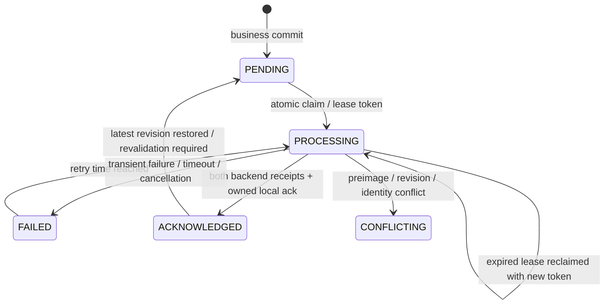

# Stage 11 — durable Seller sale outbox

Increment1 adds schema25 from authentic24, immutable identity/payload storage and leased merchant FIFO claim/ack queries. Seven new real Room tests cover migration/data preservation, migration rollback, event rollback/restart, duplicates, merchant isolation, concurrent claims and stale ownership.

Increment2 puts event insertion and the command receipt inside SaleCommands.withTransaction for create/edit/delete. Receipt replay returns before event creation. Delete events retain before-images/tombstones after physical local deletion. The four integration regressions failed before wiring (integration-before.log) and now pass. Outbox insertion failure rolls back sale/invoice/stock/cash/receipt writes together. Projection capture selects the affected sale, units and payment methods, not a copy of the entire merchant database. Backup format22 carries immutable outbox history and resets restored processing leases. Existing best-effort delete calls were removed from Seller screen mutation paths; background dispatch is the next increment.

Infrastructure and integration full JVM suites and unchanged coverage gates pass. No production Firebase services were contacted. Hosted checks and remote protocol runtime acceptance are not yet established by these results.

Increment3: leased dispatcher and WorkManager worker/lifecycle scaffolding compile; ten real Room dispatcher tests and the full JVM suite pass with unchanged coverage gates. Tests cover failure/backoff, timeout/restart, cancellation, logout/switch, concurrent workers, expired-owner completion, newer revision in flight, explicit conflict blocking and failed local acknowledgment after remote success. Acknowledgments compare event ID, revision and a fresh per-claim ownership token; expired owners cannot complete. No database transaction is held during transport. A conflict blocks later merchant events because stock/cash resources can be shared. Retry delay is capped at6h; intent is never discarded for reaching an attempt limit. Actual Firebase wiring and WorkManager runtime verification follow in Increment4.

## Increment4 — conditional Firebase integration and consumers

The production adapter now uses server-retried transactions in each backend, checks before-images and aggregate heads, and stores immutable event receipts with effects. Firestore and RTDB are separate phases; only both completed phases permit local acknowledgment. Stable document IDs are upserts, stock/cash are conditional absolute projections, and all remote deletions have durable tombstone events. A second-phase conflict after Firestore is explicitly retained, not called distributed atomicity. See [server contract and deployment limits](stage11-server-contract.md).

The retired SaleSync direct-delete implementation and its four tests were replaced with four actual CoroutineWorker tests for restart recovery, merchant switching, remote failure and cancellation. The lifecycle observes committed sequence changes/current merchant, schedules connected WorkManager work with bounded backoff, and registers periodic recovery. Backup restoration explicitly wakes/replaces work after commit. UI mutations use the current merchant, and a SavedStateHandle-bound draft cannot be retargeted to a different account. Legacy startup string caching no longer controls sale command ownership.

Seller-specific optional fences stop legacy transaction/invoice/return upload and unversioned replay from bypassing managed events/tombstones. Shared stock/cash/product retry paths defer while owned events are pending and filter known foreign-merchant records. Receipt-aware reads/writes are fenced in Room. An unknown unversioned remote deletion is quarantined as CONFLICT instead of guessing cash/stock reversals; Admin bindings keep their prior defaults. Managed returns are journaled around the existing full local return transaction so a later partial-return deletion has a complete remote sequence. Standalone legacy cash effects schedule uploads after their own transaction commits; nested effects leave dispatch to the owning outbox. This timing regression failed before repair.

Restore cannot remove or rewrite any known immutable event history or clear a conflict. It invalidates leases, revalidates the latest acknowledged revision per aggregate, preserves historical acknowledgments and reserves deleted numeric aggregate IDs in sqlite_sequence. Tests first reproduced both erased deletion intent and reused deleted IDs on a fresh restored database. Older/incompatible historical restores now fail closed before modifying financial data; reconciliation is required instead of silently losing remote intent.

Verified checkpoint:201 JVM tests passed,0 failed,0 skipped. The unchanged shared branch gate initially failed at18.7856%; six real Room tenant/cash timing tests raised shared branch coverage to20.8375% without lowering thresholds or adding exclusions. Protocol tests also reproduced/repaired wrapped SDK conflicts, remote-ahead acknowledgments from older restores, and loss of unrelated RTDB fields. Final broader acceptance and packaging follow in Increment5/6.

## Increment5 — final behavioral regression acceptance

The full JVM run passes **202 tests: shared85 + Seller117, zero failures/errors/skips**. Stage10 had144 tests. This increment adds62 test methods and retires4 obsolete best-effort SaleSync tests in favor of4 real CoroutineWorker tests (net+58). The final additional regression proves that even an identical-content newer revision stays PENDING until its own receipt: comparing field equality alone cannot acknowledge an ABA revision. JUnit suite counts are in evidence/continuation/stage11/final-test-inventory.json; the complete Gradle run and unchanged gate results are beside it. No instrumentation execution is included in this number.

| Required behavior | Executed regression evidence |
| --- | --- |
| Business/event commit and rollback | SaleCommandsTest.commitCreatesExactlyOneOutboxEventAndReplayDoesNotDuplicateIt; outboxInsertFailureRollsBackSaleStockCashAndReceipt |
| Duplicate operation | duplicateSubmissionHasExactlyOneLocalEffect; concurrentIdenticalSubmissionsApplyOnce |
| Durable immutable restart | restartKeepsCommittedOutboxPayloadUnchanged; SaleOutboxStorageTest.eventSurvivesDatabaseRestart |
| Failed upload/backoff | OutboxDispatcherTest.remoteFailureRetainsIdentityAndRetriesAfterBackoff |
| Timeout and restart | timeoutAndRestartKeepDeletionIntent |
| Cancellation | cancellationReleasesClaimWithoutAcknowledging; SaleOutboxWorkerTest.cancelledWorkerPreservesRetryIntent |
| Two workers | concurrentDispatchersDoNotClaimOneEventTwice |
| Lease expiry | expiredOwnershipRejectsOldNetworkCompletion |
| New financial revision in flight | SaleCommandsTest.realEditDuringOldUploadKeepsNewFinancialRowsPendingUntilItsOwnReceipt |
| Identical-content new revision in flight | identicalContentRevisionIsNotAcknowledgedByAnOlderEventReceipt |
| Create then edit | createThenEditDeliversBothImmutableRevisionsInOrder |
| Create then delete/tombstone | createThenDeleteDeliversTombstoneAndNetZeroCashAndStock |
| Return then deletion | relatedReturnAndPartialDeletionAreDurableAndDeliverableInOneSequence; actualReturnRepositoryJournalsStockCashAndReturnBeforeLegacyUploads |
| Logout/account switch | OutboxDispatcherTest.logoutDuringDispatchCancelsOldMerchantAndRetainsIntent; merchantSwitchNeverClaimsAnotherTenant |
| UI session switch | SaleSessionViewModelTest (2 tests); staleUiMerchantCannotCreateAnEventUnderThePreviousSession |
| Repeated remote delivery | FirebaseOutboxTransportTest.repeatedDeliveryUsesBothReceiptsWithoutReapplyingFinancialEffects |
| Partial backend completion | failureBetweenBackendsRetainsCompletedPhaseForIdempotentRetry; secondBackendConflictIsExplicitRatherThanClaimedAtomicSuccess |
| Explicit conflict | conflictingFirestoreValueIsNotOverwritten; sdkWrappedConflictRemainsExplicitAndDoesNotBecomeInfiniteTransientRetry |
| Failed local acknowledgment | OutboxDispatcherTest.failedLocalAcknowledgmentKeepsUncertainRemoteCompletionRetryable |
| Restore during upload | SaleCommandsTest.restoreDuringDispatchInvalidatesOldLeaseAndReplaysRemoteReceiptSafely |
| Old restore losing tombstone | olderBackupCannotEraseAnUncertainDeletionTombstone |
| Old restore versus newer server | oldAcknowledgedRestoreBecomesConflictIfRemoteRevisionHasAdvanced |
| Immutable restore and deleted identities | restoreCannotRewriteExistingImmutablePayloadUnderTheSameEventId; freshRestoreDoesNotReuseADeletedAggregateIdentity |
| Legacy unversioned echo | unversionedTransactionEchoCannotOverwriteOrResurrectManagedSale; unversionedInvoiceEchoCannotResurrectDeletedManagedLines |
| Migration preservation/rollback | SaleOutboxMigrationTest (2 tests), authentic exported24→compiler-generated25 |

These use real Room/SQLite under Robolectric, transaction callbacks of the production Firebase adapter with deterministic SDK fakes, and WorkManager's worker test builder. Firebase Emulator Suite, actual Firebase authorization/rules and real server transactions were **NOT TESTED**. No production Firebase was accessed. Existing Stage10 failure/return/cancellation/last-stock tests remain passing.

### Actual transaction boundaries

```mermaid
sequenceDiagram
    participant UI
    participant Command as Seller command
    participant DB as Room / SQLite
    participant Worker
    participant FS as Firestore
    participant RT as Realtime Database
    UI->>Command: stable operation ID + merchant + expected revision
    Command->>DB: BEGIN withTransaction
    Command->>DB: validate receipt, owner, stock and revision
    Command->>DB: sale / invoice / stock ledger / cash / return effects
    Command->>DB: immutable outbox event + operation receipt
    Command->>DB: COMMIT (or rollback every local effect)
    Worker->>DB: transactionally claim merchant FIFO with fresh lease token
    Worker->>FS: conditional effects + head + event receipt
    Worker->>RT: conditional effects + head + event receipt
    Note over FS,RT: Separate backend commits; partial completion is possible
    Worker->>DB: token/revision-checked acknowledgment + matching local statuses
```

Debt is still derived from committed transactions; no debt ledger was introduced. Network dispatch happens outside the business transaction. Managed-return hooks nest inside the same Room transaction. Admin bindings retain defaults; no Admin business source changes were made.



CONFLICTING requires explicit reconciliation and blocks subsequent merchant financial events. A vanished worker leaves a recoverable expiring lease. Retry identity never changes. Tombstones and receipt history are retained; no retention policy silently drops financial intent.

### Measured coverage

| Scope | Lines | Branches |
| --- | --- | --- |
| Weighted overall | 4841/27930 =17.3326% | 1306/17331 =7.5356% |
| Seller only | 1098/17769 =6.1793% | 684/14346 =4.7679% |
| Shared | 3743/10161 =36.8369% | 622/2985 =20.8375% |

Starting Stage10 measured weighted lines3746/26848 =13.9526% and branches906/16479 =5.4979%; Seller lines716/17459 =4.1010% and branches425/13972 =3.0418%. All existing floors pass unchanged; no production exclusions were added. The initial shared-branch gate failure is preserved in shared-gate-before.log, not hidden. Coverage is JVM debug coverage, not device or minified runtime coverage.
