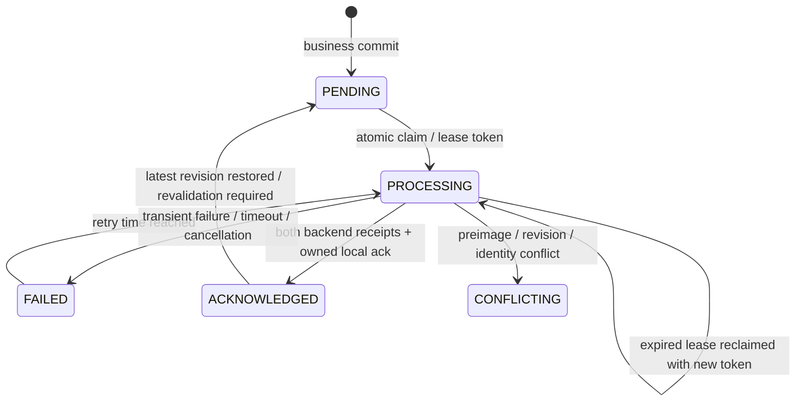
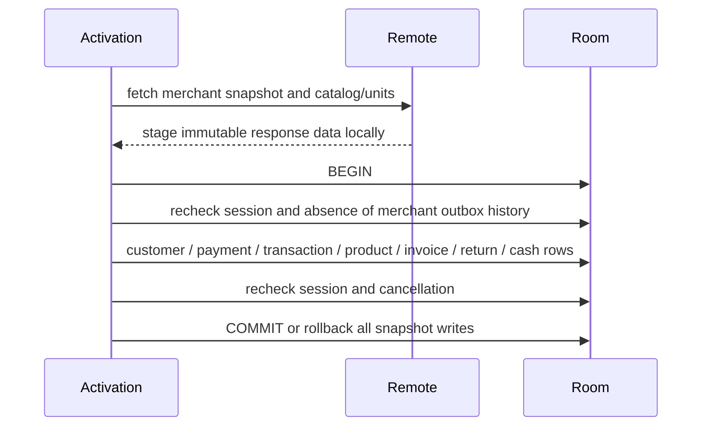

# Stage 11 — durable Seller sale outbox

Increment1 adds schema25 from authentic24, immutable identity/payload storage and leased merchant FIFO claim/ack queries. Seven new real Room tests cover migration/data preservation, migration rollback, event rollback/restart, duplicates, merchant isolation, concurrent claims and stale ownership.

Increment2 puts event insertion and the command receipt inside SaleCommands.withTransaction for create/edit/delete. Receipt replay returns before event creation. Delete events retain before-images/tombstones after physical local deletion. The four integration regressions failed before wiring (integration-before.log) and now pass. Outbox insertion failure rolls back sale/invoice/stock/cash/receipt writes together. Projection capture selects the affected sale, units and payment methods, not a copy of the entire merchant database. Backup format22 carries immutable outbox history and resets restored processing leases. Existing best-effort delete calls were removed from Seller screen mutation paths; background dispatch is the next increment.

Infrastructure and integration full JVM suites and unchanged coverage gates pass. No production Firebase services were contacted. Hosted checks and remote protocol runtime acceptance are not yet established by these results.

Increment3: leased dispatcher and WorkManager worker/lifecycle scaffolding compile; ten real Room dispatcher tests and the full JVM suite pass with unchanged coverage gates. Tests cover failure/backoff, timeout/restart, cancellation, logout/switch, concurrent workers, expired-owner completion, newer revision in flight, explicit conflict blocking and failed local acknowledgment after remote success. Acknowledgments compare event ID, revision and a fresh per-claim ownership token; expired owners cannot complete. No database transaction is held during transport. A conflict blocks later merchant events because stock/cash resources can be shared. Retry delay is capped at6h; intent is never discarded for reaching an attempt limit. Actual Firebase wiring and WorkManager runtime verification follow in Increment4.

## Increment4 — conditional Firebase integration and consumers

The production adapter now uses server-retried transactions in each backend, checks before-images and aggregate heads, and stores immutable event receipts with effects. Firestore and RTDB are separate phases; only both completed phases permit local acknowledgment. Stable document IDs are upserts, stock/cash are conditional absolute projections, and all remote deletions have durable tombstone events. A second-phase conflict after Firestore is explicitly retained, not called distributed atomicity. See [server contract and deployment limits](stage11-server-contract.md).

The retired SaleSync direct-delete implementation and its four tests were replaced with four actual CoroutineWorker tests for restart recovery, merchant switching, remote failure and cancellation. The lifecycle observes committed sequence changes/current merchant, schedules connected WorkManager work with bounded backoff, and registers periodic recovery. Backup restoration explicitly wakes/replaces work after commit. UI mutations use the current merchant, and a SavedStateHandle-bound draft cannot be retargeted to a different account. Legacy startup string caching no longer controls sale command ownership.

Seller-specific optional fences stop legacy transaction/invoice/return upload and unversioned replay from bypassing managed events/tombstones. Shared stock/cash/product retry paths defer while owned events are pending and filter known foreign-merchant records. Receipt-aware reads/writes are fenced in Room. An unknown unversioned remote deletion is quarantined as CONFLICT instead of guessing cash/stock reversals; Admin bindings keep their prior defaults. Managed returns are journaled around the existing full local return transaction so a later partial-return deletion has a complete remote sequence. Standalone legacy cash effects schedule uploads after their own transaction commits; nested effects leave dispatch to the owning outbox. This timing regression failed before repair.

Restore cannot remove or rewrite any known immutable event history or clear a conflict. It invalidates leases, revalidates the latest acknowledged revision per aggregate, preserves historical acknowledgments and reserves deleted numeric aggregate IDs in sqlite_sequence. Tests first reproduced both erased deletion intent and reused deleted IDs on a fresh restored database. Older/incompatible historical restores now fail closed before modifying financial data; reconciliation is required instead of silently losing remote intent.

Verified checkpoint:201 JVM tests passed,0 failed,0 skipped. The unchanged shared branch gate initially failed at18.7856%; six real Room tenant/cash timing tests raised shared branch coverage to20.8375% without lowering thresholds or adding exclusions. Protocol tests also reproduced/repaired wrapped SDK conflicts, remote-ahead acknowledgments from older restores, and loss of unrelated RTDB fields. Final broader acceptance and packaging follow in Increment5/6.

## Increment5 — final behavioral regression acceptance

The full JVM run passes **202 tests: shared85 + Seller117, zero failures/errors/skips**. Stage10 had144 tests. This increment adds62 test methods and retires4 obsolete best-effort SaleSync tests in favor of4 real CoroutineWorker tests (net+58). The final additional regression proves that even an identical-content newer revision stays PENDING until its own receipt: comparing field equality alone cannot acknowledge an ABA revision. JUnit suite counts are in evidence/continuation/stage11/final-test-inventory.json; the complete Gradle run and unchanged gate results are beside it. No instrumentation execution is included in this number.

| Required behavior | Executed regression evidence |
| --- | --- |
| Business/event commit and rollback | SaleCommandsTest.commitCreatesExactlyOneOutboxEventAndReplayDoesNotDuplicateIt; outboxInsertFailureRollsBackSaleStockCashAndReceipt |
| Duplicate operation | duplicateSubmissionHasExactlyOneLocalEffect; concurrentIdenticalSubmissionsApplyOnce |
| Durable immutable restart | restartKeepsCommittedOutboxPayloadUnchanged; SaleOutboxStorageTest.eventSurvivesDatabaseRestart |
| Failed upload/backoff | OutboxDispatcherTest.remoteFailureRetainsIdentityAndRetriesAfterBackoff |
| Timeout and restart | timeoutAndRestartKeepDeletionIntent |
| Cancellation | cancellationReleasesClaimWithoutAcknowledging; SaleOutboxWorkerTest.cancelledWorkerPreservesRetryIntent |
| Two workers | concurrentDispatchersDoNotClaimOneEventTwice |
| Lease expiry | expiredOwnershipRejectsOldNetworkCompletion |
| New financial revision in flight | SaleCommandsTest.realEditDuringOldUploadKeepsNewFinancialRowsPendingUntilItsOwnReceipt |
| Identical-content new revision in flight | identicalContentRevisionIsNotAcknowledgedByAnOlderEventReceipt |
| Create then edit | createThenEditDeliversBothImmutableRevisionsInOrder |
| Create then delete/tombstone | createThenDeleteDeliversTombstoneAndNetZeroCashAndStock |
| Return then deletion | relatedReturnAndPartialDeletionAreDurableAndDeliverableInOneSequence; actualReturnRepositoryJournalsStockCashAndReturnBeforeLegacyUploads |
| Logout/account switch | OutboxDispatcherTest.logoutDuringDispatchCancelsOldMerchantAndRetainsIntent; merchantSwitchNeverClaimsAnotherTenant |
| UI session switch | SaleSessionViewModelTest (2 tests); staleUiMerchantCannotCreateAnEventUnderThePreviousSession |
| Repeated remote delivery | FirebaseOutboxTransportTest.repeatedDeliveryUsesBothReceiptsWithoutReapplyingFinancialEffects |
| Partial backend completion | failureBetweenBackendsRetainsCompletedPhaseForIdempotentRetry; secondBackendConflictIsExplicitRatherThanClaimedAtomicSuccess |
| Explicit conflict | conflictingFirestoreValueIsNotOverwritten; sdkWrappedConflictRemainsExplicitAndDoesNotBecomeInfiniteTransientRetry |
| Failed local acknowledgment | OutboxDispatcherTest.failedLocalAcknowledgmentKeepsUncertainRemoteCompletionRetryable |
| Restore during upload | SaleCommandsTest.restoreDuringDispatchInvalidatesOldLeaseAndReplaysRemoteReceiptSafely |
| Old restore losing tombstone | olderBackupCannotEraseAnUncertainDeletionTombstone |
| Old restore versus newer server | oldAcknowledgedRestoreBecomesConflictIfRemoteRevisionHasAdvanced |
| Immutable restore and deleted identities | restoreCannotRewriteExistingImmutablePayloadUnderTheSameEventId; freshRestoreDoesNotReuseADeletedAggregateIdentity |
| Legacy unversioned echo | unversionedTransactionEchoCannotOverwriteOrResurrectManagedSale; unversionedInvoiceEchoCannotResurrectDeletedManagedLines |
| Migration preservation/rollback | SaleOutboxMigrationTest (2 tests), authentic exported24→compiler-generated25 |

These use real Room/SQLite under Robolectric, transaction callbacks of the production Firebase adapter with deterministic SDK fakes, and WorkManager's worker test builder. Firebase Emulator Suite, actual Firebase authorization/rules and real server transactions were **NOT TESTED**. No production Firebase was accessed. Existing Stage10 failure/return/cancellation/last-stock tests remain passing.

### Actual transaction boundaries

```mermaid
sequenceDiagram
    participant UI
    participant Command as Seller command
    participant DB as Room / SQLite
    participant Worker
    participant FS as Firestore
    participant RT as Realtime Database
    UI->>Command: stable operation ID + merchant + expected revision
    Command->>DB: BEGIN withTransaction
    Command->>DB: validate receipt, owner, stock and revision
    Command->>DB: sale / invoice / stock ledger / cash / return effects
    Command->>DB: immutable outbox event + operation receipt
    Command->>DB: COMMIT (or rollback every local effect)
    Worker->>DB: transactionally claim merchant FIFO with fresh lease token
    Worker->>FS: conditional effects + head + event receipt
    Worker->>RT: conditional effects + head + event receipt
    Note over FS,RT: Separate backend commits; partial completion is possible
    Worker->>DB: token/revision-checked acknowledgment + matching local statuses
```

Debt is still derived from committed transactions; no debt ledger was introduced. Network dispatch happens outside the business transaction. Managed-return hooks nest inside the same Room transaction. Admin bindings retain defaults; no Admin business source changes were made.



CONFLICTING requires explicit reconciliation and blocks subsequent merchant financial events. A vanished worker leaves a recoverable expiring lease. Retry identity never changes. Tombstones and receipt history are retained; no retention policy silently drops financial intent.

### Measured coverage (final aggregate rebuild)

| Scope | Lines | Branches |
| --- | --- | --- |
| Weighted overall | 4840/27930 =17.3290% | 1306/17271 =7.5618% |
| Seller only | 1099/17769 =6.1849% | 684/14286 =4.7879% |
| Shared | 3741/10161 =36.8172% | 622/2985 =20.8375% |

Starting Stage10 measured weighted lines3746/26848 =13.9526% and branches906/16479 =5.4979%; Seller lines716/17459 =4.1010% and branches425/13972 =3.0418%. All existing floors pass unchanged; no production exclusions were added. The initial shared-branch gate failure is preserved in shared-gate-before.log, not hidden. Coverage is JVM debug coverage, not device or minified runtime coverage.

## Increment6 — builds, security policy and release decision

The full final packaging run executes Android Lint, Debug assembly, instrumentation APK assembly and actual R8 minification for the unsigned Release. The new test dependency uses the existing WorkManager version via the version catalog; no lint suppression was introduced. Final acceptance logs, lint issue counts and APK SHA256 values are in evidence/continuation/stage11/. Release signature verification intentionally reports missing signature metadata, confirming the QA APK is unsigned. Production signing material and Crashlytics mapping upload were not used.

`python3 scripts/check-seller-secrets.py` passes its targeted tracked-signing/server-credential/token-log policy. This is not a historical secret scan or dependency advisory audit. No Admin files or coverage thresholds were changed. The offline packaging Firebase fixture was restored before committing. Historical schema versions1–21 remain BLOCKED without authentic fixtures; no fabricated schemas or destructive fallback were used.

Git push to the existing audit branch works. GitHub REST Actions and GraphQL PR reads both return Forbidden from the environment. Consequently new hosted `seller` and `compose` conclusions, a new run URL, and the remote PR description update are **BLOCKED**. The updated reviewable description is docs/qa/draft-pr-body.md; branch pushes update the existing PR's diff. No new PR, merge or force push was performed. User-reported starting run [41422131934](https://github.com/mohammedakkad/SalesManager/actions/runs/41422131934) had both jobs SUCCESS; it is historical evidence for Stage10, not the new Stage11 HEAD. Device instrumentation and Android-generated PDFBox verification were not rerun locally: **NOT TESTED/BLOCKED**. Instrumentation APK compilation does not count as runtime success.

### Remaining P0/P1 and readiness

- **P0:** no verified deployed server authorization, immutable event/head enforcement, or fencing of legacy/privileged clients. A client SDK transaction is insufficient to enforce all writers' financial rules.
- **P0/P1:** Firestore and RTDB cannot commit together; partial completion is explicit and retained, but trusted reconciliation and per-resource enforcement remain server work. No global exactly-once claim.
- **P1:** universal tenant partitioning/ownership of legacy caches and adoption of manual financial writers remain incomplete; current sale guards do not prove every legacy feature safe after account switching.
- **P1:** cross-device numeric identity collisions, remote baseline provisioning, versioned pulls, large-account RTDB root transaction behavior and conflict resolution need a deployed reviewed contract.
- **P1:** authentic migration fixtures1–21, historical signing/security remediation and real signed/minified upgrade/device/backup validation remain unresolved.
- Hosted new-HEAD/device/PDF and Firebase Emulator/deployed-rule acceptance are unverified, independently of local passing tests.

**Release readiness: FAIL.** Local sale/outbox architecture and tests are implemented; remaining distributed and verification limits are explicit in stage11-server-contract.md. Start SHA:aed0074bce2b1cd5b63765736e6872587a1c23ce. Coherent stages are committed/pushed on codex/seller-full-coverage-audit; use git log for final immutable commit identities.

Final lint result after the version-catalog repair: **0 errors,24 warnings**. See evidence/continuation/stage11/final-lint-summary.json; incompatible dependency lint registries remain among the warnings.

Final aggregate verification: **BUILD SUCCESSFUL in9m6s (227 executed tasks)**, complete JVM suites/JaCoCo/Lint/Debug/instrumentation APK/minified unsigned Release. See final-acceptance.log for the exact measured duration and task outcomes; unchanged gates PASS in final-acceptance-gates.log. APK hashes are in final-apk-hashes.json.

The final full aggregate rebuild regenerates the measured JaCoCo counters above. Earlier checkpoint logs are retained as historical evidence; final-acceptance-gates.log is authoritative for the ending tree. No coverage exclusions or thresholds changed.


## Continuation — 2026-11-08: acknowledge all sales when a merchant queue drains

Starting HEAD:d67707286be6ee1d06a56524e22c2bb42b9f9688. A real two-sale scenario revealed that the first sale's local rows stayed PENDING after both remote receipts were acknowledged. The existing merchant-wide outstanding guard correctly prevented premature shared-stock/cash acknowledgment, but the final receipt only reconciled its own snapshot. This left an earlier aggregate's transaction/invoice/ledgers pending indefinitely, including across restart.

Before repair, both new SaleCommandsTest cases failed with `Sale 1 remains pending after its receipt and queue drain expected SYNCED but was PENDING`: drainingMultipleSalesAcknowledgesEveryMatchingSaleAndLedger and restartBetweenReceiptsDoesNotStrandEarlierSaleAsPending. See evidence/continuation/stage11-drain/before.log and before-junit.xml.

After the exact owned event is acknowledged, a drained merchant queue reconciles the latest acknowledged snapshot of **each** aggregate. A Room query excludes other merchants and all superseded revisions; pages of64 bound payload memory. Snapshot equality/ownership checks still gate every local status update, and the pending-merchant guard still blocks stale/identical-content acknowledgment while a newer event is outstanding. All reconciliation remains inside the receipt's Room transaction: failure or cancellation rolls back the receipt and statuses together. No network requests, financial balances, revision semantics, schema version or conflict policy changed.

The regressions assert both transaction states, both invoice/stock ledgers, cash ledger/box state and unchanged cash/stock values. One closes/reopens SQLite between receipts. Existing stale/ABA, cancellation, restore, foreign-merchant and failed-ack cases remain part of the full suite. A drain can scan one latest snapshot per historical aggregate; paging bounds memory but not total transaction time. Large-account latency is not benchmarked, and a future durable dirty-resource index may reduce this work. This does not close the distributed/server release blockers documented above.

Intermediate two-case checkpoint:204 JVM tests PASS (shared85/Seller119),0 failures/errors/skips. Unchanged gates PASS. Weighted coverage:lines4848/28004 =17.3118%, branches1310/17289 =7.5771%; Seller:lines1105/17776 =6.2162%, branches688/14292 =4.8139%. The added compiler-generated DAO paging implementation expands the coverage denominator. No exclusions or floors changed. See stage11-drain/after.log, coverage-gates.log and test-counts.json; these supersede the earlier checkpoint for this continuation.

A third regression, idleRestartRepairsRowsStrandedByPreviouslyAcknowledgedReceipts, reproduced the persisted state left by the older implementation: both backend receipts are real in the deterministic protocol fake and both outbox rows are ACKNOWLEDGED, while local statuses remain PENDING. It also failed before repair (stage11-drain/idle-before.log and idle-before-junit.xml). An idle dispatcher now reconciles only when the merchant queue is truly drained, in a Room transaction, so startup/periodic work repairs old local status rows without waiting for a new sale or invoking transport. A future retry/conflict/processing event still blocks reconciliation. The test closes/reopens SQLite and rejects any network dispatch during recovery.

### Final continuation acceptance

Final continuation acceptance:205 JVM tests PASS (shared85/Seller120),0 failures/errors/skips;3 new regression methods. Unchanged coverage gates PASS. Weighted lines4855/28010 =17.3331%, branches1313/17293 =7.5927%; Seller lines1112/17782 =6.2535%, branches691/14296 =4.8335%. Lint0 errors/24 warnings; Debug/instrumentation APK and actual minified unsigned Release builds PASS. Signed/device/PDF/Firebase runtime was not executed. Hosted CI and remote PR metadata remain BLOCKED by api.github.com access policy/Forbidden. Release readiness remains FAIL.

Combined Gradle validation:BUILD SUCCESSFUL in4m8s,227 tasks (33 executed/194 up-to-date). final-acceptance.log and final-coverage-gates.log are authoritative for this continuation; final-test-inventory.json records suite counts. lint-summary.json and apk-hashes.json preserve final measurements; unsigned-verification.log confirms absent signature metadata. The temporary offline Firebase fixture was restored before commit. No Admin files, exported schemas, coverage floors or production signing inputs changed. Room remains25; no new migration is required. Earlier204-test results are intermediate checkpoints, superseded by205.

Environment on resume:the existing branch fetch confirms starting HEADd67707286be6ee1d06a56524e22c2bb42b9f9688. GitHub Actions REST read for that full SHA returned Forbidden; applied restricted policy does not include api.github.com. Native Git access succeeds. No current hosted run URL/conclusion or remote PR description update is claimed. No /dev/kvm exists in this environment; native/device/PDF runtime acceptance remains unverified. Existing server enforcement, partial-backend reconciliation, legacy tenant/cache isolation, historical1–21 fixtures and security/upgrade blockers remain unchanged.


Remote publication BLOCKED:Git fetch succeeded, but the normal branch push of verified local commit3607cbc returned HTTP403 Permission denied. This continuation is committed locally and is not confirmed on PR51/the remote branch. Restore repository write authorization through the environment/GitHub integration settings before retrying; do not supply tokens in chat. See evidence/continuation/stage11-drain/push-blocked.log.


## Continuation — reconciliation cancellation and SQLite faults

Starting local HEAD:fd445f8443c17fe9cfae1b2890d06cbc78a447e2. Added real SQLite tests for a failure during the last receipt's status reconciliation, failure during idle recovery, cancellation during reconciliation and cancellation during idle recovery. Test QueryCallback uses a direct executor to cancel the worker after the second sale status write begins; no sleeps or production test hooks are used. Triggers abort a later status update after earlier aggregate updates have run.

Before repair, the two SQLite failure tests passed, but cancellationDuringDrainRollsBackEarlierStatusesAndCanRetryAfterRestart failed:the worker was cancelled while Room's transaction continued through non-suspending DAO calls and committed synchronization statuses. Evidence:stage11-cancellation/before.log and before-junit.xml (3 tests,1 failure). This was a cancellation-boundary failure, not an invented partial financial mutation or duplicate remote effect.

The dispatcher now checks coroutine cancellation explicitly before completing both receipt and idle-recovery transactions and before each reconciliation page. A cancellation observed there aborts Room's transaction, reverting earlier status writes and the newly written local acknowledgment together. Existing NonCancellable retry handling retains uncertain remote completion with stable event identity. Idle recovery leaves all acknowledged receipt metadata unchanged. No network request was moved into a Room transaction; no schema or financial rule changed.

The targeted three tests pass after repair (targeted-after.log/XML). A fourth test also covers cancellation of idle recovery. Tests close/reopen SQLite, compare complete financial-row snapshots, assert receipt states, and retry against existing deterministic backend receipts without additional remote financial writes. They exercise the production Room/dispatcher/conditional protocol; they do not establish deployed Firebase enforcement.

### Final cancellation increment evidence

Current cancellation-boundary increment:4 new real Room tests;209 JVM tests PASS (shared85/Seller124),0 failures/errors/skips. A synchronous query callback reproduced cancellation after status writes had started;1 of the initial3 tests failed before the repair, while the2 SQLite fault tests already passed. Explicit coroutine checks now guard both transaction completions and each reconciliation page. The targeted3 and final4 new cases pass, including restart/reuse of completed remote receipts without additional financial effects. Full aggregate build PASS in4m20s (227 tasks:41 executed/186 up-to-date), including Lint, Debug/instrumentation APK and actual minified unsigned Release. Lint0 errors/24 warnings; targeted secret policy PASS. Weighted lines4856/28012 =17.3354%, branches1315/17295 =7.6034%; Seller lines1113/17784 =6.2584%, branches693/14298 =4.8468%. All gates unchanged and passing. Room remains25; no schema, Admin files or financial rules changed. Device/PDF/deployed Firebase runtime remains NOT TESTED/BLOCKED. Release readiness FAIL; prior server/legacy-tenant/historical-migration risks remain.

Authoritative logs:stage11-cancellation/final-acceptance.log and final-coverage-gates.log; final-test-inventory.json lists actual suites; lint-summary.json, apk-hashes.json, unsigned-verification.log and secret-policy.log preserve measurements. Temporary offline packaging config was restored before commit. Native Git fetch confirms remote starting HEADd67707286be6ee1d06a56524e22c2bb42b9f9688; earlier verified local commits remain preserved. GitHub API remains excluded by the enforced policy, so no new hosted job conclusion or run URL is claimed.


Publication of cancellation increment BLOCKED:normal push of local commitc02ba3f returned HTTP403 Permission denied. The verified source/tests and evidence are local; PR51 and remote hosted execution are not confirmed updated. GitHub integration write authorization must be restored through environment/account settings; no token values are requested in chat. Evidence:stage11-cancellation/push-blocked.log.


## Continuation — avoid redundant idle reconciliation writes

Starting local HEAD:20d49e9051418592793b50e0d1651e3c9b867960. Two real SQLite trigger-audit regressions reproduced redundant updates during idle recovery. A fully synchronized sale generated six SYNCED→SYNCED updates on every wakeup (12 across two calls); recovery of one FAILED invoice also rewrote five already-synchronized rows. Both assertions failed before repair; see evidence/continuation/stage11-idle-writes/before.log/XML.

Reconciliation now skips rows already marked SYNCED across transaction, invoice, unit, cash box, stock ledger, return and cash movement snapshots. Unsynchronized rows still require the existing full snapshot/merchant checks. Receipt claim/acknowledgment, cancellation checkpoints, immutable identity and financial values are unchanged. This reduces redundant SQL updates/Room invalidations; no measured battery or latency improvement is claimed. Full-history reads still scale with historical aggregates and remain an unbenchmarked limitation.

The trigger audit verifies zero synchronization writes across repeated settled recovery and exactly one FAILED→SYNCED invoice update for partial local recovery, with unchanged balances/stock and no transport calls. These are production Room/dispatcher tests, not simulated host PDFs or production Firebase operations.


## Idle-write continuation acceptance

Two new trigger-audit Room regressions fail before and pass after repair. Current suite:211 JVM tests PASS (shared85/Seller126),0 failures/errors/skips. Repeated settled idle recovery produces zero syncStatus updates; partial recovery updates only the matching FAILED invoice. Existing failure/cancellation/restart/ABA cases pass. Unchanged coverage gates PASS. Weighted lines4866/28022 =17.3649%, branches1327/17309 =7.6665%; Seller lines1123/17794 =6.3111%, branches705/14312 =4.9259%. Lint0 errors/24 warnings, targeted secret policy PASS, Debug/instrumentation APK/minified unsigned Release builds PASS (4m11s). Room remains25; no Admin/schema/financial-rule/coverage-floor changes. Full-history reads remain an unbenchmarked limitation. Device/PDF/Firebase runtime and hosted new-HEAD acceptance remain NOT TESTED/BLOCKED. Release readiness FAIL; existing distributed/server/legacy-tenant risks remain. Evidence:docs/qa/evidence/continuation/stage11-idle-writes/. Previous publication attempts returned403; no current hosted success is established.


Publication recovered:normal push succeeded and native git ls-remote confirmed remote source HEADcf41f02d5b3f0d66380f9fd49ceb6df39a4a3f58. All five previously local commits are now on the existing audit branch/PR diff. Earlier403 entries remain historical evidence. Runtime network revision4 still excludes api.github.com; new hosted seller/compose conclusions, exact run URL and remote PR-description edit remain BLOCKED. Do not infer CI success from the successful push. No merge or force push occurred.


## Hosted evidence — public GitHub interface

Hosted verification now observed through permitted github.com public HTML:Seller QA run42522749601 (https://github.com/mohammedakkad/SalesManager/actions/runs/42522749601) is SUCCESS at audited HEADb243ec4715167496fcbfe9bd5f33bfde0e919a9c. Both seller (8m51s) and compose (6m30s) completed successfully. The emulator step and artifact upload explicitly report success; the summary lists2 artifact packages. This supersedes earlier claims that hosted job conclusions are inaccessible. REST/GraphQL access and remote PR-description editing remain blocked. Exact raw device/JVM/PDF XML and individual PDFs were not downloaded:public UI requires login for logs and anonymous log/artifact endpoints returned404. The audited fail-closed device script requires all4 named instrumentation cases in successful XML and then pulls both nonempty Android PDFs and runs PDFBox. Thus successful pipeline execution is evidenced, but exact2 PDFBox case counts/content and retained PDF bytes have not been independently inspected. Do not equate local211 JVM results with hosted test counts. Release readiness remainsFAIL for server enforcement, partial cross-backend reconciliation, legacy tenant/cache isolation and historical1–21/security/upgrade blockers. Sanitized source evidence:evidence/continuation/stage11-hosted/public-hosted-evidence.json. No production source or workflow changed in this documentation increment; new documentation-HEAD CI is not yet verified.


## Seller activation import: late snapshot and rollback repair

Starting HEAD5a382891b2c5687f50237bc9a431e0e2aed55a91. Repository inspection found no maintained Firebase security-rules/functions configuration. Activation stores a merchant code/activated flag locally; this is not a server membership proof. Server-rule changes cannot be inferred from that code, and no deployment/production access was performed.

A separate local defect was reproduced in four real Room tests:3 failed before repair and1 positive import passed. The old code checked outbox history only before the network request and wrote imported rows through individually swallowed exceptions. A committed event or logout while the fetch waited did not prevent a stale import; an injected cash-box insert failure left earlier customer/transaction writes committed. Genuine before evidence:stage11-activation/before.log and before-junit.xml. An initial JUnit setup-return error was corrected and is NOT counted as a behavioral failure.

Seller bindings supply outboxDatabase. Only that path now stages MerchantData plus catalog/unit network reads before a single Room transaction, rechecks current merchant/activation/history under that transaction, writes the complete snapshot without swallowing individual DAO faults, recalculates hasItems, rechecks activation and checks cancellation before completion. Local exceptions roll back all import rows before a class-only warning is logged. Cancellation propagates. The existing best-effort activation Unit API is retained so an import failure does not become an uncaught UI exception; activation preferences are outside Room and may remain set, as before. No successful financial/debt/return calculation changed. Admin bindings with no outboxDatabase follow the original implementation.



No network I/O is performed inside the Seller import transaction. Staging catalog data increases in-memory retention; large-account import performance remains unbenchmarked. This repair does not establish universal tenant partitioning, cross-device identity safety, or a versioned server pull protocol. Those and activation identity/authorization remain release blockers. The request for the authoritative server-rule source and identity-to-merchant contract remains open.


## Seller activation-import acceptance

Seller activation-import increment:4 real Room tests,3 behavioral failures before repair and all4 passing after. Full JVM suite215 PASS (shared89/Seller126),0 failures/errors/skips. Late replies after managed operation/logout no longer import, and injected local failure rolls back the complete import without an uncaught activation UI error. All unchanged coverage gates PASS. Weighted lines4974/28061 =17.7257%, branches1348/17329 =7.7789%; Seller lines1123/17794 =6.3111%, branches705/14312 =4.9259%. Lint0 errors/24 warnings; targeted secret policy PASS; Debug/instrumentation APK/minified unsigned Release builds PASS in4m59s. Room remains25. No Admin source, exported schemas, coverage floors or production signing changed. Staged catalog memory and large-account latency remain unbenchmarked. Activation preferences remain outside Room and the best-effort activation API is preserved; universal tenant partitioning/server authorization remain unresolved. Prior hosted run42522749601 validates b243ec4 only; hosted acceptance for this new source is pending. Release readiness FAIL. Evidence:evidence/continuation/stage11-activation/.


## Gradle provisioning follow-up

Hosted run42572865642 at source2abd4b0 failed Compose before emulator execution:SDK provisioning succeeded, Install verified Gradle exited22, KVM/emulator steps were skipped. Public annotations do not expose which download URL or HTTP response failed. This is not a device/PDF test failure or a failure of the local activation regressions. Both Seller QA jobs now use scripts/setup-seller-gradle.sh:official downloads.gradle.org source, pinned independently verified Gradle8.9 SHA256, bounded retries, TLS verification and captured stderr. The second checksum HTTP request is removed; checksum enforcement is retained. A real fresh install/Gradle invocation passes, shell syntax passes, and a deterministic corrupt-download probe is rejected before unzip/PATH registration. New hosted acceptance is pending. Local production215 JVM tests, coverage gates and APK/lint checks remain the prior verified activation results; no production code changed in this CI-only increment. Release readiness FAIL. Evidence:evidence/continuation/stage11-gradle/.


## Final hosted activation/Gradle acceptance

Final hosted acceptance recovered:Seller QA run42573505456 at audited source HEAD129490d0d1ec4eabe2dd6157323adb7d46809e93 is SUCCESS (https://github.com/mohammedakkad/SalesManager/actions/runs/42573505456). Both seller and compose completed successfully, including verified Gradle provisioning, hosted test/coverage/lint/Debug step, unsigned minified Release step, emulator/device/PDF script and artifact upload. This supersedes the earlier pending/new-source status and the failed Compose download run42572865642. Sanitized public job/step evidence:stage11-gradle/hosted-after.json. Raw uploaded XML/PDF files were not independently downloaded; exact hosted case counters remain unextracted. Local215 JVM tests and authentic before/after activation evidence remain separately recorded. Server rules/identity contract, distributed reconciliation and legacy tenant isolation remain unresolved; release readiness FAIL. This evidence validates source129490d; a subsequent documentation-only commit is not claimed to have completed CI.


## Expanded activation qualification tests

Test-only qualification expansion:6 new real Room/network-fake cases cover unit download failure, product-unit SQL failure after earlier writes, successful catalog import with network outside Room, account switch during fetch, cancellation during unit download and cancellation during cash insertion. Snapshot comparisons now include product/unit, invoice, return, receipt/outbox and cash ledgers. Targeted10 import tests and complete221 JVM tests PASS (shared95/Seller126),0 failures/errors/skips. Both Test tasks executed; complete Gradle run succeeded in1m15s. Unchanged coverage gates and targeted secret policy PASS. Weighted lines4980/28061 =17.7471%, branches1348/17329 =7.7789%; Seller lines1123/17794 =6.3111%, branches705/14312 =4.9259%. No production, Admin, schema, financial-rule or coverage-floor changes; no new repair or failing-before claim is made for these6 qualification cases. Lint/APKs were not rerun in this test-only increment; the unchanged production source has successful prior local/hosted acceptance at129490d. New test-HEAD hosted validation is pending. Real Firebase/device/PDF artifact-counter limits and server-rule/tenant/distributed blockers remain; release readiness FAIL. Evidence:stage11-expanded-tests/.


## Hosted expanded-test acceptance

Hosted qualification completed:Seller QA run42577182702 at test HEADa717f9ee11d87953a70ebecf21a4331406331142 is SUCCESS (https://github.com/mohammedakkad/SalesManager/actions/runs/42577182702). Both seller and compose completed successfully, including hosted test/coverage/lint/Debug, minified unsigned Release, emulator and artifact steps. This supersedes the pending status for the six-test expansion. Local221 passing JVM tests are recorded from actual JUnit XML; raw hosted XML/PDF counters were not separately downloaded. Sanitized public job evidence:stage11-expanded-tests/hosted-success.json. Subsequent documentation-only CI is not claimed complete. No production/Admin/schema changes occurred in the test expansion. Release readiness remainsFAIL for previously documented server/tenant/distributed/upgrade limits.


## Coverage target 40% acceptance (2026-11-09)

Both requested line targets now pass: Seller **7668/17795 =43.0908%**; weighted shared+Seller **11525/28062 =41.0698%** (summed counters, not a mean of percentages). Branches: Seller3703/14316 =25.8662%, weighted4346/17333 =25.0736%. Starting source dff4876 had221 JVM tests, Seller1123/17794 =6.3111%, weighted4980/28061 =17.7471%. This stage adds35 JVM behavioral tests:27 offline Compose journeys,4 ReportsViewModel calculations,4 actual XLSX/OpenXML export checks. Complete256 JVM tests pass (shared95/Seller161),0 failures/errors/skips;5 separate Python coverage-gate tests also pass.

Four XLSX content regressions failed before the repair:shared strings were serialized before registration, duplicate fills inflated their count, and solid-fill references used a reserved index. XlsxWriter now serializes the populated string table and consistent fill references. Actual ZIP/XML data, Arabic/XML escaping, literal formulas, totals and stock values are checked. No financial rules, Admin business logic, schema or coverage exclusions changed. Seller LINE floor is raised3→40%; weighted LINE40% is now enforced independently. Existing shared and branch floors remain unchanged.

Final combined JVM/JaCoCo/Lint/Debug/AndroidTest/minified unsigned Release Gradle run succeeds; Lint0 errors/24 warnings. Release signature verification rejects the APK as expected (unsigned; no production signing material). Targeted secret policy and diff whitespace checks pass. Test application uses Config.NONE/plain Application; no production Firebase service is contacted. Coverage is JVM debug coverage, not device/release runtime coverage. See coverage40-progress.md and evidence/continuation/coverage40/final/ for actual counters, build logs, APK hashes and lint XML; XLSX before/after evidence is under coverage40/xlsx/.

Hosted milestone run42583691086:Compose SUCCESS; Seller FAILED in Install verified Gradle, before tests (later Seller test/build steps skipped). This is not a passing hosted test claim. Final-source hosted verification is pending. No raw hosted XML/PDF artifacts have been independently downloaded. Server authorization/identity rules, partial-backend reconciliation, legacy tenant isolation and authentic historical migration/real upgrade evidence remain release blockers. Release readiness remains **FAIL**, independently of achieving both coverage targets.


## Final hosted coverage acceptance

Seller QA run42586688384 at source **47148214d22f15097f30e8b7374e735648a597f6** completed **SUCCESS**:both **seller SUCCESS** and **compose SUCCESS**. URL:https://github.com/mohammedakkad/SalesManager/actions/runs/42586688384 . All14 Seller job steps and11 Compose job steps show success, including hosted tests/coverage/40% floors/Lint/Debug, minified unsigned Release, emulator/device/PDF verification and artifact upload. This supersedes final-source pending status above. The device script fails unless all4 named instrumentation cases execute/pass in XML, both Android-generated PDFs are nonempty and the2 real PDFBox content tests pass; the hosted script step succeeded. Raw hosted XML/PDF files and hosted numerical coverage counters were not independently downloaded. Local exact256 JVM/5 Python results and line numerators/denominators remain separately recorded.

Evidence:evidence/continuation/coverage40/final/hosted-success.json plus jvm-cases.json and counters/build logs. This verifies source4714821; the following documentation-only commit is not claimed as another completed CI run. Updating PR51 body via gh was blocked by Forbidden at api.github.com/graphql; its proposed current body is saved as draft-pr-body.md, and branch commits are pushed to the existing PR. No merge or new PR. Both requested40% line targets are achieved without exclusions; overall release readiness remainsFAIL for the previously documented server/tenant/distributed/upgrade blockers.
