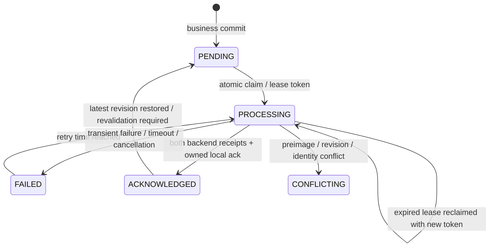

# Stage 11 — durable Seller sale outbox

Increment1 adds schema25 from authentic24, immutable identity/payload storage and leased merchant FIFO claim/ack queries. Seven new real Room tests cover migration/data preservation, migration rollback, event rollback/restart, duplicates, merchant isolation, concurrent claims and stale ownership.

Increment2 puts event insertion and the command receipt inside SaleCommands.withTransaction for create/edit/delete. Receipt replay returns before event creation. Delete events retain before-images/tombstones after physical local deletion. The four integration regressions failed before wiring (integration-before.log) and now pass. Outbox insertion failure rolls back sale/invoice/stock/cash/receipt writes together. Projection capture selects the affected sale, units and payment methods, not a copy of the entire merchant database. Backup format22 carries immutable outbox history and resets restored processing leases. Existing best-effort delete calls were removed from Seller screen mutation paths; background dispatch is the next increment.

Infrastructure and integration full JVM suites and unchanged coverage gates pass. No production Firebase services were contacted. Hosted checks and remote protocol runtime acceptance are not yet established by these results.

Increment3: leased dispatcher and WorkManager worker/lifecycle scaffolding compile; ten real Room dispatcher tests and the full JVM suite pass with unchanged coverage gates. Tests cover failure/backoff, timeout/restart, cancellation, logout/switch, concurrent workers, expired-owner completion, newer revision in flight, explicit conflict blocking and failed local acknowledgment after remote success. Acknowledgments compare event ID, revision and a fresh per-claim ownership token; expired owners cannot complete. No database transaction is held during transport. A conflict blocks later merchant events because stock/cash resources can be shared. Retry delay is capped at6h; intent is never discarded for reaching an attempt limit. Actual Firebase wiring and WorkManager runtime verification follow in Increment4.

## Increment4 — conditional Firebase integration and consumers

The production adapter now uses server-retried transactions in each backend, checks before-images and aggregate heads, and stores immutable event receipts with effects. Firestore and RTDB are separate phases; only both completed phases permit local acknowledgment. Stable document IDs are upserts, stock/cash are conditional absolute projections, and all remote deletions have durable tombstone events. A second-phase conflict after Firestore is explicitly retained, not called distributed atomicity. See [server contract and deployment limits](stage11-server-contract.md).

The retired SaleSync direct-delete implementation and its four tests were replaced with four actual CoroutineWorker tests for restart recovery, merchant switching, remote failure and cancellation. The lifecycle observes committed sequence changes/current merchant, schedules connected WorkManager work with bounded backoff, and registers periodic recovery. Backup restoration explicitly wakes/replaces work after commit. UI mutations use the current merchant, and a SavedStateHandle-bound draft cannot be retargeted to a different account. Legacy startup string caching no longer controls sale command ownership.

Seller-specific optional fences stop legacy transaction/invoice/return upload and unversioned replay from bypassing managed events/tombstones. Shared stock/cash/product retry paths defer while owned events are pending and filter known foreign-merchant records. Receipt-aware reads/writes are fenced in Room. An unknown unversioned remote deletion is quarantined as CONFLICT instead of guessing cash/stock reversals; Admin bindings keep their prior defaults. Managed returns are journaled around the existing full local return transaction so a later partial-return deletion has a complete remote sequence. Standalone legacy cash effects schedule uploads after their own transaction commits; nested effects leave dispatch to the owning outbox. This timing regression failed before repair.

Restore cannot remove or rewrite any known immutable event history or clear a conflict. It invalidates leases, revalidates the latest acknowledged revision per aggregate, preserves historical acknowledgments and reserves deleted numeric aggregate IDs in sqlite_sequence. Tests first reproduced both erased deletion intent and reused deleted IDs on a fresh restored database. Older/incompatible historical restores now fail closed before modifying financial data; reconciliation is required instead of silently losing remote intent.

Verified checkpoint:201 JVM tests passed,0 failed,0 skipped. The unchanged shared branch gate initially failed at18.7856%; six real Room tenant/cash timing tests raised shared branch coverage to20.8375% without lowering thresholds or adding exclusions. Protocol tests also reproduced/repaired wrapped SDK conflicts, remote-ahead acknowledgments from older restores, and loss of unrelated RTDB fields. Final broader acceptance and packaging follow in Increment5/6.

## Increment5 — final behavioral regression acceptance

The full JVM run passes **202 tests: shared85 + Seller117, zero failures/errors/skips**. Stage10 had144 tests. This increment adds62 test methods and retires4 obsolete best-effort SaleSync tests in favor of4 real CoroutineWorker tests (net+58). The final additional regression proves that even an identical-content newer revision stays PENDING until its own receipt: comparing field equality alone cannot acknowledge an ABA revision. JUnit suite counts are in evidence/continuation/stage11/final-test-inventory.json; the complete Gradle run and unchanged gate results are beside it. No instrumentation execution is included in this number.

| Required behavior | Executed regression evidence |
| --- | --- |
| Business/event commit and rollback | SaleCommandsTest.commitCreatesExactlyOneOutboxEventAndReplayDoesNotDuplicateIt; outboxInsertFailureRollsBackSaleStockCashAndReceipt |
| Duplicate operation | duplicateSubmissionHasExactlyOneLocalEffect; concurrentIdenticalSubmissionsApplyOnce |
| Durable immutable restart | restartKeepsCommittedOutboxPayloadUnchanged; SaleOutboxStorageTest.eventSurvivesDatabaseRestart |
| Failed upload/backoff | OutboxDispatcherTest.remoteFailureRetainsIdentityAndRetriesAfterBackoff |
| Timeout and restart | timeoutAndRestartKeepDeletionIntent |
| Cancellation | cancellationReleasesClaimWithoutAcknowledging; SaleOutboxWorkerTest.cancelledWorkerPreservesRetryIntent |
| Two workers | concurrentDispatchersDoNotClaimOneEventTwice |
| Lease expiry | expiredOwnershipRejectsOldNetworkCompletion |
| New financial revision in flight | SaleCommandsTest.realEditDuringOldUploadKeepsNewFinancialRowsPendingUntilItsOwnReceipt |
| Identical-content new revision in flight | identicalContentRevisionIsNotAcknowledgedByAnOlderEventReceipt |
| Create then edit | createThenEditDeliversBothImmutableRevisionsInOrder |
| Create then delete/tombstone | createThenDeleteDeliversTombstoneAndNetZeroCashAndStock |
| Return then deletion | relatedReturnAndPartialDeletionAreDurableAndDeliverableInOneSequence; actualReturnRepositoryJournalsStockCashAndReturnBeforeLegacyUploads |
| Logout/account switch | OutboxDispatcherTest.logoutDuringDispatchCancelsOldMerchantAndRetainsIntent; merchantSwitchNeverClaimsAnotherTenant |
| UI session switch | SaleSessionViewModelTest (2 tests); staleUiMerchantCannotCreateAnEventUnderThePreviousSession |
| Repeated remote delivery | FirebaseOutboxTransportTest.repeatedDeliveryUsesBothReceiptsWithoutReapplyingFinancialEffects |
| Partial backend completion | failureBetweenBackendsRetainsCompletedPhaseForIdempotentRetry; secondBackendConflictIsExplicitRatherThanClaimedAtomicSuccess |
| Explicit conflict | conflictingFirestoreValueIsNotOverwritten; sdkWrappedConflictRemainsExplicitAndDoesNotBecomeInfiniteTransientRetry |
| Failed local acknowledgment | OutboxDispatcherTest.failedLocalAcknowledgmentKeepsUncertainRemoteCompletionRetryable |
| Restore during upload | SaleCommandsTest.restoreDuringDispatchInvalidatesOldLeaseAndReplaysRemoteReceiptSafely |
| Old restore losing tombstone | olderBackupCannotEraseAnUncertainDeletionTombstone |
| Old restore versus newer server | oldAcknowledgedRestoreBecomesConflictIfRemoteRevisionHasAdvanced |
| Immutable restore and deleted identities | restoreCannotRewriteExistingImmutablePayloadUnderTheSameEventId; freshRestoreDoesNotReuseADeletedAggregateIdentity |
| Legacy unversioned echo | unversionedTransactionEchoCannotOverwriteOrResurrectManagedSale; unversionedInvoiceEchoCannotResurrectDeletedManagedLines |
| Migration preservation/rollback | SaleOutboxMigrationTest (2 tests), authentic exported24→compiler-generated25 |

These use real Room/SQLite under Robolectric, transaction callbacks of the production Firebase adapter with deterministic SDK fakes, and WorkManager's worker test builder. Firebase Emulator Suite, actual Firebase authorization/rules and real server transactions were **NOT TESTED**. No production Firebase was accessed. Existing Stage10 failure/return/cancellation/last-stock tests remain passing.

### Actual transaction boundaries

```mermaid
sequenceDiagram
    participant UI
    participant Command as Seller command
    participant DB as Room / SQLite
    participant Worker
    participant FS as Firestore
    participant RT as Realtime Database
    UI->>Command: stable operation ID + merchant + expected revision
    Command->>DB: BEGIN withTransaction
    Command->>DB: validate receipt, owner, stock and revision
    Command->>DB: sale / invoice / stock ledger / cash / return effects
    Command->>DB: immutable outbox event + operation receipt
    Command->>DB: COMMIT (or rollback every local effect)
    Worker->>DB: transactionally claim merchant FIFO with fresh lease token
    Worker->>FS: conditional effects + head + event receipt
    Worker->>RT: conditional effects + head + event receipt
    Note over FS,RT: Separate backend commits; partial completion is possible
    Worker->>DB: token/revision-checked acknowledgment + matching local statuses
```

Debt is still derived from committed transactions; no debt ledger was introduced. Network dispatch happens outside the business transaction. Managed-return hooks nest inside the same Room transaction. Admin bindings retain defaults; no Admin business source changes were made.



CONFLICTING requires explicit reconciliation and blocks subsequent merchant financial events. A vanished worker leaves a recoverable expiring lease. Retry identity never changes. Tombstones and receipt history are retained; no retention policy silently drops financial intent.

### Measured coverage (final aggregate rebuild)

| Scope | Lines | Branches |
| --- | --- | --- |
| Weighted overall | 4840/27930 =17.3290% | 1306/17271 =7.5618% |
| Seller only | 1099/17769 =6.1849% | 684/14286 =4.7879% |
| Shared | 3741/10161 =36.8172% | 622/2985 =20.8375% |

Starting Stage10 measured weighted lines3746/26848 =13.9526% and branches906/16479 =5.4979%; Seller lines716/17459 =4.1010% and branches425/13972 =3.0418%. All existing floors pass unchanged; no production exclusions were added. The initial shared-branch gate failure is preserved in shared-gate-before.log, not hidden. Coverage is JVM debug coverage, not device or minified runtime coverage.

## Increment6 — builds, security policy and release decision

The full final packaging run executes Android Lint, Debug assembly, instrumentation APK assembly and actual R8 minification for the unsigned Release. The new test dependency uses the existing WorkManager version via the version catalog; no lint suppression was introduced. Final acceptance logs, lint issue counts and APK SHA256 values are in evidence/continuation/stage11/. Release signature verification intentionally reports missing signature metadata, confirming the QA APK is unsigned. Production signing material and Crashlytics mapping upload were not used.

`python3 scripts/check-seller-secrets.py` passes its targeted tracked-signing/server-credential/token-log policy. This is not a historical secret scan or dependency advisory audit. No Admin files or coverage thresholds were changed. The offline packaging Firebase fixture was restored before committing. Historical schema versions1–21 remain BLOCKED without authentic fixtures; no fabricated schemas or destructive fallback were used.

Git push to the existing audit branch works. GitHub REST Actions and GraphQL PR reads both return Forbidden from the environment. Consequently new hosted `seller` and `compose` conclusions, a new run URL, and the remote PR description update are **BLOCKED**. The updated reviewable description is docs/qa/draft-pr-body.md; branch pushes update the existing PR's diff. No new PR, merge or force push was performed. User-reported starting run [41422131934](https://github.com/mohammedakkad/SalesManager/actions/runs/41422131934) had both jobs SUCCESS; it is historical evidence for Stage10, not the new Stage11 HEAD. Device instrumentation and Android-generated PDFBox verification were not rerun locally: **NOT TESTED/BLOCKED**. Instrumentation APK compilation does not count as runtime success.

### Remaining P0/P1 and readiness

- **P0:** no verified deployed server authorization, immutable event/head enforcement, or fencing of legacy/privileged clients. A client SDK transaction is insufficient to enforce all writers' financial rules.
- **P0/P1:** Firestore and RTDB cannot commit together; partial completion is explicit and retained, but trusted reconciliation and per-resource enforcement remain server work. No global exactly-once claim.
- **P1:** universal tenant partitioning/ownership of legacy caches and adoption of manual financial writers remain incomplete; current sale guards do not prove every legacy feature safe after account switching.
- **P1:** cross-device numeric identity collisions, remote baseline provisioning, versioned pulls, large-account RTDB root transaction behavior and conflict resolution need a deployed reviewed contract.
- **P1:** authentic migration fixtures1–21, historical signing/security remediation and real signed/minified upgrade/device/backup validation remain unresolved.
- Hosted new-HEAD/device/PDF and Firebase Emulator/deployed-rule acceptance are unverified, independently of local passing tests.

**Release readiness: FAIL.** Local sale/outbox architecture and tests are implemented; remaining distributed and verification limits are explicit in stage11-server-contract.md. Start SHA:aed0074bce2b1cd5b63765736e6872587a1c23ce. Coherent stages are committed/pushed on codex/seller-full-coverage-audit; use git log for final immutable commit identities.

Final lint result after the version-catalog repair: **0 errors,24 warnings**. See evidence/continuation/stage11/final-lint-summary.json; incompatible dependency lint registries remain among the warnings.

Final aggregate verification: **BUILD SUCCESSFUL in9m6s (227 executed tasks)**, complete JVM suites/JaCoCo/Lint/Debug/instrumentation APK/minified unsigned Release. See final-acceptance.log for the exact measured duration and task outcomes; unchanged gates PASS in final-acceptance-gates.log. APK hashes are in final-apk-hashes.json.

The final full aggregate rebuild regenerates the measured JaCoCo counters above. Earlier checkpoint logs are retained as historical evidence; final-acceptance-gates.log is authoritative for the ending tree. No coverage exclusions or thresholds changed.


## Continuation — 2026-11-08: acknowledge all sales when a merchant queue drains

Starting HEAD:d67707286be6ee1d06a56524e22c2bb42b9f9688. A real two-sale scenario revealed that the first sale's local rows stayed PENDING after both remote receipts were acknowledged. The existing merchant-wide outstanding guard correctly prevented premature shared-stock/cash acknowledgment, but the final receipt only reconciled its own snapshot. This left an earlier aggregate's transaction/invoice/ledgers pending indefinitely, including across restart.

Before repair, both new SaleCommandsTest cases failed with `Sale 1 remains pending after its receipt and queue drain expected SYNCED but was PENDING`: drainingMultipleSalesAcknowledgesEveryMatchingSaleAndLedger and restartBetweenReceiptsDoesNotStrandEarlierSaleAsPending. See evidence/continuation/stage11-drain/before.log and before-junit.xml.

After the exact owned event is acknowledged, a drained merchant queue reconciles the latest acknowledged snapshot of **each** aggregate. A Room query excludes other merchants and all superseded revisions; pages of64 bound payload memory. Snapshot equality/ownership checks still gate every local status update, and the pending-merchant guard still blocks stale/identical-content acknowledgment while a newer event is outstanding. All reconciliation remains inside the receipt's Room transaction: failure or cancellation rolls back the receipt and statuses together. No network requests, financial balances, revision semantics, schema version or conflict policy changed.

The regressions assert both transaction states, both invoice/stock ledgers, cash ledger/box state and unchanged cash/stock values. One closes/reopens SQLite between receipts. Existing stale/ABA, cancellation, restore, foreign-merchant and failed-ack cases remain part of the full suite. A drain can scan one latest snapshot per historical aggregate; paging bounds memory but not total transaction time. Large-account latency is not benchmarked, and a future durable dirty-resource index may reduce this work. This does not close the distributed/server release blockers documented above.

Intermediate two-case checkpoint:204 JVM tests PASS (shared85/Seller119),0 failures/errors/skips. Unchanged gates PASS. Weighted coverage:lines4848/28004 =17.3118%, branches1310/17289 =7.5771%; Seller:lines1105/17776 =6.2162%, branches688/14292 =4.8139%. The added compiler-generated DAO paging implementation expands the coverage denominator. No exclusions or floors changed. See stage11-drain/after.log, coverage-gates.log and test-counts.json; these supersede the earlier checkpoint for this continuation.

A third regression, idleRestartRepairsRowsStrandedByPreviouslyAcknowledgedReceipts, reproduced the persisted state left by the older implementation: both backend receipts are real in the deterministic protocol fake and both outbox rows are ACKNOWLEDGED, while local statuses remain PENDING. It also failed before repair (stage11-drain/idle-before.log and idle-before-junit.xml). An idle dispatcher now reconciles only when the merchant queue is truly drained, in a Room transaction, so startup/periodic work repairs old local status rows without waiting for a new sale or invoking transport. A future retry/conflict/processing event still blocks reconciliation. The test closes/reopens SQLite and rejects any network dispatch during recovery.

### Final continuation acceptance

Final continuation acceptance:205 JVM tests PASS (shared85/Seller120),0 failures/errors/skips;3 new regression methods. Unchanged coverage gates PASS. Weighted lines4855/28010 =17.3331%, branches1313/17293 =7.5927%; Seller lines1112/17782 =6.2535%, branches691/14296 =4.8335%. Lint0 errors/24 warnings; Debug/instrumentation APK and actual minified unsigned Release builds PASS. Signed/device/PDF/Firebase runtime was not executed. Hosted CI and remote PR metadata remain BLOCKED by api.github.com access policy/Forbidden. Release readiness remains FAIL.

Combined Gradle validation:BUILD SUCCESSFUL in4m8s,227 tasks (33 executed/194 up-to-date). final-acceptance.log and final-coverage-gates.log are authoritative for this continuation; final-test-inventory.json records suite counts. lint-summary.json and apk-hashes.json preserve final measurements; unsigned-verification.log confirms absent signature metadata. The temporary offline Firebase fixture was restored before commit. No Admin files, exported schemas, coverage floors or production signing inputs changed. Room remains25; no new migration is required. Earlier204-test results are intermediate checkpoints, superseded by205.

Environment on resume:the existing branch fetch confirms starting HEADd67707286be6ee1d06a56524e22c2bb42b9f9688. GitHub Actions REST read for that full SHA returned Forbidden; applied restricted policy does not include api.github.com. Native Git access succeeds. No current hosted run URL/conclusion or remote PR description update is claimed. No /dev/kvm exists in this environment; native/device/PDF runtime acceptance remains unverified. Existing server enforcement, partial-backend reconciliation, legacy tenant/cache isolation, historical1–21 fixtures and security/upgrade blockers remain unchanged.
