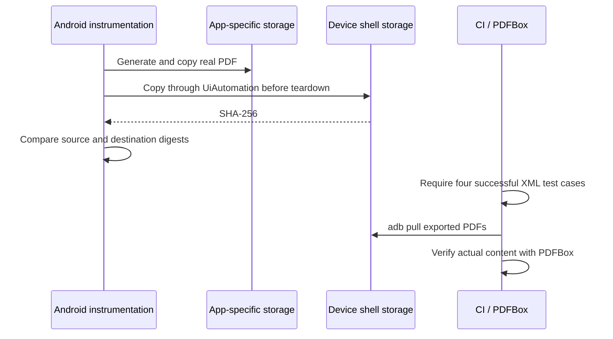

# Stage 9 — partial implementation evidence

Release readiness: **FAIL**. This increment is a PDF artifact transport change, not completion of Stage 9.

Starting audit HEAD: `2b1e54c36ff5c316812733d4504268fd11b4b7cc`.

## Device artifacts

User-provided run 41278106326: seller SUCCESS; compose FAILURE after Gradle success, while pulling app-specific external PDF storage. API retrieval of run metadata and logs returned Forbidden in this session. Original instrumentation XML/device logs were not retrieved. APK uninstall/cleanup is a plausible mechanism, not a confirmed diagnosis from logs.

The source uses ApplicationProvider application context and getExternalFilesDir(null), not instrumentation package context. OfflineQaRunner replaces the Seller Application with a plain Application and refuses a production Firebase project. No test cleanup in PdfFixtureTest removes its external copies. The new export copies each actual Android-generated file through UiAutomation shell access while instrumentation is still alive to an explicitly shell-owned /data/local/tmp/seller-qa-pdf directory. The source path is derived from the actual Context. The test asserts existence and compares SHA-256 of the source with the exported destination. Each test logs package, source, destination and digest. No host PDFs are synthesized and existing content assertions remain unchanged.

CI clears previous device exports, requires the four named tests to pass in XML, pulls the independent directory, checks both files exist and runs the unchanged two-test PDFBox suite. A trap preserves path logs and attempts artifact recovery on failure. These are proposed mechanics until device runtime verification succeeds; no four-test or PDFBox runtime pass is claimed.

## Business integrity status

Atomic sale commands and transactional outbox are **NOT IMPLEMENTED**. Inspection reconfirmed that the ViewModel commits transaction/cash before invoice and stock, edit restores stock separately, and delete has no aggregate transaction. Cash provisioning can fetch remote state and stock/invoice writers launch network work, so wrapping existing public repository calls would not satisfy the required design. Debt remains derived from unpaid transaction rows.

Schema remains 23. No migration changes or fabricated historical schemas. Versions 1–21 remain BLOCKED pending authentic fixtures. No new rollback/restart/concurrency acceptance tests have been implemented. No distributed exactly-once or last-write-wins guarantee is asserted. P0 aggregate atomicity and durable deletion/sync intent remain unresolved implementation work, not external access blockers.

## Validation boundary

New behavioral test methods: 0; existing PDF fixtures gain export assertions. No Admin business logic changes. Tests use the existing offline Firebase packaging generator, not the production configuration supplied in chat. GitHub API/PR update and remote run inspection are BLOCKED by API Forbidden. No local KVM device is present. Hosted results, device tests and real Android PDFBox verification remain BLOCKED. Coverage, lint, debug/release builds and new migration acceptance must be reported only from completed runs; prior Stage 8 baselines are not new Stage 9 results.

Completed local validation: full JVM suites **104 passed, 0 failed, 0 skipped** (70 core + 34 Seller), including existing real Room tests; instrumentation APK assembly **PASS**, not a device run. See `evidence/continuation/stage9/jvm-and-instrumentation-build.log`. JDK17 was downloaded from the official Temurin release and checksum verified; the system Java CA trust store was used for the configured proxy. Initial Java21 runtime-only/jlink and downloaded-JDK CA issues were corrected without disabling TLS verification. Signing/server-credential policy and diff whitespace check passed.
